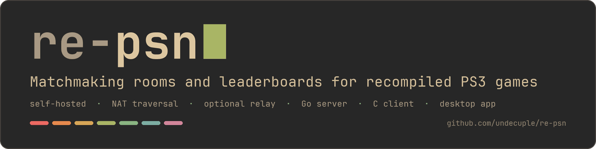
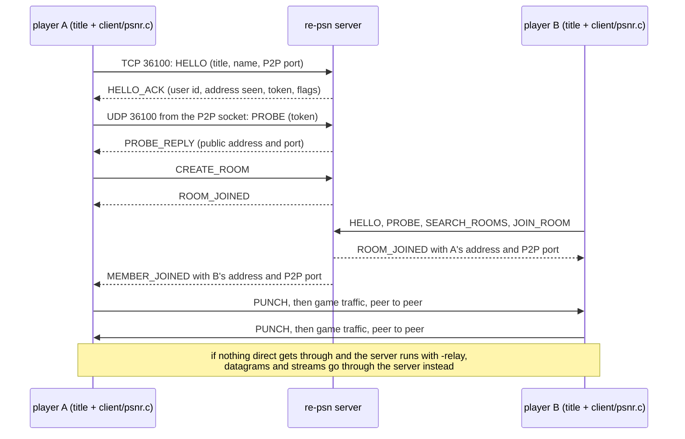

# re-psn



**Run your own matchmaking and leaderboard server for statically recompiled PS3 games: one small binary, no accounts, no cloud.**

[](https://github.com/undecuple/re-psn/actions/workflows/ci.yml) <!-- version --><!-- /version --> 
 [](https://deepwiki.com/undecuple/re-psn)

> [!IMPORTANT]
> **Bring your own game.** This repository has no game code, assets, keys, firmware or BIOS, and you need none from it. Play
> only games you own. re-psn is not affiliated with or endorsed by Sony Interactive Entertainment.

| | |
|---|---|
| **1** static server binary | the server uses only Go's standard library; the optional desktop app uses third-party modules ([app/README.md](app/README.md)) |
| **1** port | TCP and UDP 36100 for players ([ports](docs/running.md#ports)) |
| **1** C file | the client: no third-party libraries and no threads ([client/psnr.c](client/psnr.c)) |
| **Linux and Windows** | amd64 and arm64 on Linux, amd64 on Windows ([releases](https://github.com/undecuple/re-psn/releases)) |

## Quick start: host a server

The steps for hosting a server. A game still has to be recompiled to use the [client](client/psnr.c); no shipped game is
claimed to work yet; see the [features list](docs/features.md) for what is tested.

**Linux**

1. Download the archive for your CPU from the [releases page](https://github.com/undecuple/re-psn/releases) and check it:
   `sha256sum -c SHA256SUMS --ignore-missing`.
2. Unpack it and run `./re-psn`. It listens on TCP and UDP 36100.
3. Give your players your address and port 36100 (they must not use `127.0.0.1`).

*Caveat: the newest release is a pre-release; behind a router you must forward TCP and UDP 36100 ([ways to connect](docs/connecting.md)).*

**Windows**

1. Download the `.zip` from the releases page and compare `Get-FileHash` with the line in `SHA256SUMS`.
2. Unzip it and run `re-psn.exe`.
3. Allow TCP and UDP 36100 in the firewall, then give your players your address and port.

*Caveat: the release's Windows binary is cross-built and has not been run by us; the server's tests do run on Windows in CI.*

More ways to install (container, install script, from source) are under [Install](#install); the [wiki](https://github.com/undecuple/re-psn/wiki)
has short guides for players and hosts.

## What makes it different

| Claim | Proof |
|---|---|
| Nothing to sign up for: no accounts or passwords, and nothing is stored on disk except the log file if you set one | [Security and privacy](#security-and-privacy) |
| The server uses only Go's standard library | [go.mod](go.mod) has no `require` line, and CI enforces it ([ci.yml](.github/workflows/ci.yml)) |
| Players behind routers get connected, with an optional relay | tested in Docker by the [NAT lab](lab/README.md) |
| The client is one C file | [client/psnr.c](client/psnr.c), tested against the server by `client/test_psnr.c` |
| Hardened and checked | fuzz tests, race detector, vulnerability and secret scans in [CI](.github/workflows/ci.yml) |
| Every feature says how far it got | [features list](docs/features.md) with status and evidence |

## Coming soon

Not built yet; each is in the [features list](docs/features.md) and the [roadmap](ROADMAP.md) with its status: friends,
presence and invites, private rooms, an opt-in SQLite store, connection checks, a graphical desktop
client, a metrics endpoint, signed releases.

## Contents

- [Quick start: host a server](#quick-start-host-a-server)
- [What makes it different](#what-makes-it-different)
- [Coming soon](#coming-soon)
- [About this fork](#about-this-fork)
- [Overview](#overview)
- [Example](#example)
- [Features](#features)
- [Desktop app](#desktop-app)
- [For recomp developers](#for-recomp-developers)
- [Install](#install)
- [Configuration](#configuration)
- [Security and privacy](#security-and-privacy)
- [More](#more)
- [Website](#website)
- [Credits](#credits), [Licence](#licence), [How AI was used](#how-ai-was-used)

## About this fork

re-psn is a fork of [psnr](https://github.com/sp00nznet/psnr) by sp00nz, who wrote the original server, the C client and the
protocol; [LICENSE](LICENSE) keeps upstream's MIT licence and copyright line, and [NOTICE.md](NOTICE.md) credits the upstream work.
This fork adds hardened CI and fuzz tests, invite-only rooms, limits, logging, reverse proxy support, a UDP source check, container
files and release tooling; the [features list](docs/features.md) and [CHANGELOG.md](CHANGELOG.md) have the details.

## Overview

A recompiled PS3 game that wants to play online needs someone to answer its matchmaking and leaderboard calls. re-psn is that
someone, for a group running its own server: a LAN, a VPN, or friends connecting to one person's machine. The server keeps rooms
and leaderboards and tells each player where the others are; the game traffic itself goes directly between players, and through
the server only when two players cannot reach each other and the host has turned the relay on.

<details>
<summary>The message flow of a session, as a diagram</summary>



</details>

### A session, step by step

1. **The host starts re-psn**, listening on TCP and UDP 36100 (and, with `-http 127.0.0.1:36101`, a status page there).
2. **A game connects** through the C client (`client/psnr.c`): HELLO with the game's ID, the player's name and P2P port; HELLO_ACK
   returns a user id, the address the server sees, a token and flags (relay on, invite-only rooms).
3. **A UDP PROBE** from the game's P2P socket tells the server its public address and port (accepted only from the TCP address).
4. **Rooms:** one player creates a room, others search and join, or join with a code. Each member entry carries the address and
   P2P port that work from where the receiving player is.
5. **Direct:** both sides send PUNCH packets to open their routers, then play peer to peer.
6. **Relay, if needed:** when nothing direct gets through and the server runs with `-relay`, traffic goes through the server.
   Without it, players need port forwarding or a shared VPN.

Leaderboards use the same TCP connection. More in [docs/architecture.md](docs/architecture.md) (the parts, the relay) and [docs/api.md](docs/api.md) (every message).

### Using it from a game

Games are recompiled with [ps3recomp](https://github.com/sp00nznet/ps3recomp), whose NP modules talk to re-psn through the C client.
That side is upstream's work and not part of this repository: it needs a ps3recomp build with
[ps3recomp#200](https://github.com/sp00nznet/ps3recomp/pull/200) (a draft), where `PS3_NET_ONLINE=1` and `PSNR_SERVER=host[:port]`
point a game at the server (its `docs/ONLINE.md` lists the rest). With it, upstream has played Simpsons Arcade online, two players
from lobby to Stage 1 in sync, on one machine and later across two with either player behind a NAT.

## Example

Two test players meet in a room and connect directly, and the C client's test leaves a score; all captured from real local runs.

<details>
<summary>The transcripts: the server, two players, the status page and the C client test</summary>

Two test players meet in a room and connect directly. They are `lab/natcheck.c`, the NAT lab's player, which does what the
runtime does for a game (HELLO, probe, room, punch, ping, a stream) without one. Built from a fresh clone with the commands shown.

Captured from a local run on loopback: start the server with the defaults.

```text
$ ./re-psn
time=2026-11-06T01:44:42.396Z level=INFO msg=storage backend=memory
time=2026-11-06T01:44:42.396Z level=INFO msg=started version=0.2.0 clients=[::]:36100 udp=[::]:36100 relay=false
```

The status page is off by default. The rest comes from a second run of the same build, started as
`./re-psn -v -http 127.0.0.1:36101` (debug log, status page on).

Captured from a local run on loopback: build the test player, and let alice host a room in one terminal.

```text
$ gcc -std=gnu11 -o natcheck client/psnr.c lab/natcheck.c
$ ./natcheck 127.0.0.1 alice host 3658
alice: P2P socket seen at 127.0.0.1:3658
alice: the other player is at 127.0.0.1:3659
PASS alice: "PONG bob" direct
PASS alice: stream direct, got "ACK from bob"
```

Captured from a local run on loopback: in a second terminal, while alice waits, the status page shows her room; then bob joins.

```text
$ curl -s http://127.0.0.1:36101/api/stats
{"uptime":"2s","clients":1,"connections_total":1,"rooms":[{"id":1,"title":"NPWR00001_00","members":["alice"],"max":2,"age":"1s"}],"unlisted_rooms":0,"boards":[]}
$ ./natcheck 127.0.0.1 bob join 3659
bob: P2P socket seen at 127.0.0.1:3659
bob: the other player is at 127.0.0.1:3658
PASS bob: "PONG alice" direct
PASS bob: stream direct, got "SETUP from alice"
```

Captured from a local run on loopback: the C client's own test (`client/test_psnr.c`: HELLO, a room joined by a second client,
a room message, a score), then the leaderboard it left on the status page.

```text
$ gcc -std=gnu11 -o test_psnr client/psnr.c client/test_psnr.c
$ ./test_psnr 127.0.0.1 36100
test_psnr: all passed
$ curl -s http://127.0.0.1:36101/api/stats
{"uptime":"6s","clients":0,"connections_total":4,"rooms":[],"unlisted_rooms":0,"boards":[{"title":"NPWR00001_00","board":1,"entries":1,"leader":"alice","best":100}]}
```

</details>

With `-http 127.0.0.1:36101`, http://127.0.0.1:36101/ shows a terminal-style status page. Overview shows both tables;
Rooms and Leaderboards open either table separately. Below, alice is hosting a room and leads the leaderboard with 100.
The screenshot uses the old image's 1000 px width, with enough height to show both tables, and comes from a real loopback server
and protocol clients ([tools/art/capture-status.sh](tools/art/capture-status.sh) can capture another).
System/Light/Dark, text size, spacing and custom colours are [browser-local appearance settings](docs/running.md#status-page-appearance).
Routers and the relay are tested in Docker by the
[NAT lab](lab/README.md).


## Features

Available on `main` today; [docs/features.md](docs/features.md) has every feature with its status, evidence and notes.

- **Rooms:** create, search, join and leave, room and member data, owner handoff, and invite-only rooms with an 8-character code.
- **Leaderboards:** each player's best score, higher- or lower-is-better, ranked by range or by name; kept in memory for now.
- **NAT traversal:** address probes and hole punching, an optional relay, and a UDP source address check.
- **Hosting:** limits, log levels, a status page with an optional token, reverse proxy support, `RE_PSN_*` settings, Docker and
  Podman files, and deployment examples.
- **C client:** one file, no third-party libraries, no threads.
- **Checks:** fuzz tests; CI with the race detector, vulnerability and secret scans, the NAT lab and code scanning.

Partial, unverified and planned work (release archives and the AppImage, the nginx and HAProxy examples, storage backends, the
desktop apps and more) is in [ROADMAP.md](ROADMAP.md) too.

## Desktop app

[app/](app/README.md) holds the start of the desktop app, a separate Go module: a Go client for the protocol, tested against the
real server, a settings file reader, `re-psn-app check HOST:PORT`, which connects, says HELLO and reports what the server answered,
and a terminal UI (`re-psn-app` with no arguments). The UI asks on first start whether this machine plays, hosts or both, then
shows the server's rooms and one leaderboard at a time over the game protocol, and edits the settings; dark or light theme in the
website's colours. The server's version, uptime and connection counts are not available over the protocol, so the UI says so.
An explicitly configured [HTTP status source](app/README.md#optional-native-http-status) adds uptime, connection totals,
public-room members and board summaries natively, with the existing token rules and no browser. It falls back to the
game protocol when HTTP is unavailable; the server version remains unshared.
The app has no release binary: build it from source (see [app/README.md](app/README.md)). On Linux desktops, starting without a terminal can open a supported terminal; the Windows build uses its console.
See the [desktop startup instructions](app/README.md#starting-from-the-desktop) and the limits of local testing.
The terminal UI uses [Bubble Tea](https://github.com/charmbracelet/bubbletea) and [Lip Gloss](https://github.com/charmbracelet/lipgloss)
(MIT); the server module stays standard-library only. The app module needs Go 1.26 or newer; the server and the C client keep
their own requirements.

## For recomp developers

Start with [Integrating re-psn into a recompiled game](docs/integrating.md): existing ps3recomp bridge setup, direct
C/C++ integration, callback ownership, peer/relay transport and failure handling. The [minimal C example](client/examples/minimal.c)
is compiled and exercised against a loopback server by the required native-client check. Source-level runtime findings
are pinned; synthetic checks do not certify a title's gameplay or NAT behavior.

## Install

**Recommended:** download an official [release archive or AppImage](#release-archives) from the
[releases page](https://github.com/undecuple/re-psn/releases) and verify it against `SHA256SUMS`.

Releases are pre-releases for now: the newest, [v0.4.0](https://github.com/undecuple/re-psn/releases/tag/v0.4.0), is on the [releases page](https://github.com/undecuple/re-psn/releases) (see [Release archives](#release-archives)). Its container image is `ghcr.io/undecuple/re-psn:0.4.0` (see [Container](#container)).

### Optional quick install (Linux)

The installer downloads the packaged release and checks it against `SHA256SUMS`. Download this pinned script, verify
its hash and read it before running it. Each `&&` stops the sequence if the previous command fails:

```sh
curl -fsSL --proto '=https' --proto-redir '=https' --tlsv1.2 \
  -o install.sh https://raw.githubusercontent.com/undecuple/re-psn/dc0238c2407570837ab4e14b803fb260ff77742e/scripts/install.sh &&
printf '%s  install.sh\n' 'fef1f7f9a424275e45cbca80398477b4440c82b87c106ce6aa7626f3bbce1772' | sha256sum -c - &&
less install.sh &&
sh install.sh --version v0.4.0
```

This installs into `~/.local/bin` for the current user. The script comes from a pinned repository revision; the v0.4.0 release carries the same `install.sh` (identical SHA-256) as a release asset, listed in `SHA256SUMS`. See
[docs/installing.md](docs/installing.md) for options and the Windows installer.

### Optional quick install (Windows)

The same idea for Windows (amd64): download the pinned script with the `curl.exe` that ships with Windows 10 and 11, check
its hash and read it before running it. In PowerShell:

```powershell
curl.exe -fsSL --proto '=https' --proto-redir '=https' --tlsv1.2 -o install.ps1 https://raw.githubusercontent.com/undecuple/re-psn/2eb988b63eaebbe3a9bc7e7aa81c9daa3370780c/scripts/install.ps1
if ((Get-FileHash install.ps1 -Algorithm SHA256).Hash -ine '98ab633eeeffaecc6968e2fa342830ad4ceed4a5d2397a19dfcfb28e16d9d3a7') { throw 'install.ps1 does not match the pinned hash' }
notepad install.ps1
powershell -ExecutionPolicy Bypass -File install.ps1 -Version v0.4.0
```

This installs the server only (`re-psn.exe` into `%LOCALAPPDATA%\re-psn\bin`, no administrator rights, no PATH change unless you add
`-AddToPath`); there is no desktop app download yet. The script comes from a pinned repository revision, and the v0.4.0 release carries the same
`install.ps1` (identical SHA-256) as a release asset. It has been tested on PowerShell 7 only and, like the Windows binary, has not been run on Windows by us. See
[docs/installing.md](docs/installing.md) for options.

### From source

Prerequisites: Go 1.22 or newer (as in `go.mod`); a C compiler only for the C client and its tests. The quick way is `Setup.cmd`
(Windows; it offers to install Go with winget) or `./setup.sh` (Linux, macOS): both build the server in `server/` and leave a
`Start re-psn.cmd` or `start-re-psn.sh` launcher, which turns the status page on at `127.0.0.1:36101`. By hand from the repository root, captured from a local run on loopback (the
build prints nothing when it succeeds):

```text
$ go version
go version go1.26.10 linux/amd64
$ go build -o re-psn ./server
```

Run the tests with `go vet ./...` and `go test ./...` (on Linux with a C compiler, this also builds and runs the C client test).

### Container

The 0.4.0 image is on GitHub's container registry for amd64 and arm64: `docker pull ghcr.io/undecuple/re-psn:0.4.0`; 0.3.0 and 0.2.0 are still there. It is unsigned, and
the arm64 image has been built but not run. You can also build it from this repository with Docker or Podman.
[docker/README.md](docker/README.md) covers ports, the status page and Podman.

<details>
<summary>Build and run commands</summary>

```sh
docker build -f docker/Dockerfile -t re-psn .            # or: podman build -f docker/Dockerfile -t re-psn .
docker run --rm -p 36100:36100 -p 36100:36100/udp re-psn
docker compose -f docker/docker-compose.yml up -d        # the same, with a restart policy
```

It is configured only by `RE_PSN_*` variables.

</details>

### Release archives

> [!NOTE]
> [v0.4.0](https://github.com/undecuple/re-psn/releases/tag/v0.4.0) is a pre-release (GitHub marks none as "latest" yet, so use the [releases page](https://github.com/undecuple/re-psn/releases)): archives for Linux (amd64, arm64) and Windows (amd64), and an x86_64 AppImage, all unsigned. The Windows and arm64 binaries are cross-built and have not been run on those systems.

<details>
<summary>What each release carries, and how to check a download</summary>

Each release carries `re-psn-vX.Y.Z-windows-amd64.zip`, `re-psn-vX.Y.Z-linux-amd64.tar.gz` and
`re-psn-vX.Y.Z-linux-arm64.tar.gz` (built by [scripts/release-build.sh](scripts/release-build.sh)): a static `re-psn` binary
(`re-psn.exe` on Windows), `LICENSE`, `NOTICE.md` and the deployment examples in `examples/`. From v0.4.0 it also carries the
install scripts `install.sh` and `install.ps1` ([docs/installing.md](docs/installing.md)), seven assets in all (v0.3.0 has
five, without the scripts). `SHA256SUMS` lists the archives and the AppImage, and from v0.4.0 the scripts. Check a download with `sha256sum -c SHA256SUMS --ignore-missing` on Linux, or compare the output of
`Get-FileHash <archive>` with the line in `SHA256SUMS` on Windows.

Linux x86_64 also gets `re-psn-vX.Y.Z-x86_64.AppImage`, the same binary as one runnable file (unsigned): check it with
`sha256sum -c SHA256SUMS --ignore-missing`, then `chmod +x` it and run it like the binary. It needs FUSE to mount;
without it, add `--appimage-extract-and-run` as the first argument. The tarball needs neither. See
[docs/releasing.md](docs/releasing.md#the-appimage).

</details>

## Configuration

re-psn runs with no settings at all. [docs/running.md](docs/running.md) has the full text, and
[deploy/re-psn.env.example](deploy/re-psn.env.example) lists every variable with a comment.

### Settings

Each of the 21 flags can also be set as a `RE_PSN_<FLAG>` variable. A flag on the command line wins, then the variable; a value
that does not parse stops the server at start.

<details>
<summary>Every flag, its variable and its default</summary>

Variables are upper case, with dashes as underscores. Defaults are those of `./re-psn -h`.

| Flag | Variable | Default | What it does |
|---|---|---|---|
| `-addr` | `RE_PSN_ADDR` | `:36100` | TCP and UDP address for game clients |
| `-tcp-addr` | `RE_PSN_TCP_ADDR` | `-addr` | TCP address for game clients, if different |
| `-udp-addr` | `RE_PSN_UDP_ADDR` | `-addr` | UDP address for game clients, if different |
| `-http` | `RE_PSN_HTTP` | none (off) | Status page and `/api/stats` on this address, for example `127.0.0.1:36101` |
| `-http-token` | `RE_PSN_HTTP_TOKEN` | none | Token the status page requires (`Authorization: Bearer`, or `?token=`) |
| `-max-rooms` | `RE_PSN_MAX_ROOMS` | `1000` | Rooms across all titles |
| `-max-player-rooms` | `RE_PSN_MAX_PLAYER_ROOMS` | `8` | Rooms one player may be in at once (0: no limit) |
| `-max-conns-per-addr` | `RE_PSN_MAX_CONNS_PER_ADDR` | `32` | Open connections per remote address (0: no limit) |
| `-max-req-rate` | `RE_PSN_MAX_REQ_RATE` | `200` | Requests per second per connection before it is closed (0: no limit) |
| `-max-udp-rate` | `RE_PSN_MAX_UDP_RATE` | `1000` | UDP packets per second per source (IPv4 address or IPv6 /64), shared by probes and relay traffic; same-size burst (0: no limit); since v0.4.0 |
| `-v` | `RE_PSN_V` | off | Same as `-log-level debug` |
| `-log-level` | `RE_PSN_LOG_LEVEL` | `info` | `debug` (room events), `info`, `warn` or `error` |
| `-log-format` | `RE_PSN_LOG_FORMAT` | `text` | `text` or `json` |
| `-log-file` | `RE_PSN_LOG_FILE` | none | Also append the log to this file (mode 0600) |
| `-trusted-proxies` | `RE_PSN_TRUSTED_PROXIES` | none | Reverse proxies allowed to name the real client (CIDRs or addresses) |
| `-proxy-protocol` | `RE_PSN_PROXY_PROTOCOL` | off | Require a PROXY v1/v2 header from a trusted proxy on the game TCP port |
| `-udp-any-source` | `RE_PSN_UDP_ANY_SOURCE` | off | Accept UDP probes and relay packets from another address than the player's TCP one |
| `-relay` | `RE_PSN_RELAY` | off | Carry traffic for players who cannot reach each other (uses the host's bandwidth) |
| `-relay-force` | `RE_PSN_RELAY_FORCE` | off | With `-relay`, send every stream through the relay, even between players who could connect directly. For testing the relay from one network; uses the host's bandwidth |
| `-db` | `RE_PSN_DB` | `off` | Score storage: `off` or `memory` |
| `-db-file` | `RE_PSN_DB_FILE` | none | Read the `-db` setting from this file instead |
| `-replace` | `RE_PSN_REPLACE` | off | If an earlier re-psn of this user holds the game port, stop it (SIGTERM) and start in its place (Linux only) |

</details>

### Coming from PSNR_ settings or the psnr binary

Nothing breaks: the old `PSNR_<FLAG>` names still work, with a warning at start, and the binary is now `re-psn`.

<details>
<summary>The old names, the binary, the service unit and the image</summary>

Nothing breaks. The old `PSNR_<FLAG>` names are still read after `RE_PSN_<FLAG>`; when one is used, the server logs a warning at
start naming the old and the new variable, never the value. If both are set and differ, `RE_PSN_<FLAG>` wins, with a warning.
Captured from a local run on loopback:

```text
$ PSNR_MAX_ROOMS=50 ./re-psn
time=2026-11-05T22:37:03.659Z level=WARN msg="old variable name; it still works, rename it when convenient" old=PSNR_MAX_ROOMS new=RE_PSN_MAX_ROOMS
```

The binary is now `re-psn` (`re-psn.exe`); no `psnr` copy is built. The unit `re-psn.service` reads `/etc/psnr/psnr.env`, then
`/etc/re-psn/re-psn.env` (run `systemctl disable --now psnr` first); the image and compose service are `re-psn` (use
`--remove-orphans` once). The Go module path, the C client's `psnr_*` API and the wire format keep upstream's names.

</details>

### Ports

| Port | Protocol | Open to |
|---|---|---|
| 36100 | TCP and UDP | Every player: game connection and address probes |
| 36101 | TCP | You only, when `-http` turns the status page on: it lists every online ID |
| each player's P2P port (3658 unless the game's `PS3_NET_P2P_PORT` says otherwise) | UDP and TCP | The other players; the game opens it |

Players on one LAN or VPN need nothing forwarded. Firewall commands are in [docs/running.md](docs/running.md#firewall).

### Reverse proxy, status page, limits and storage

What to set before the server goes behind a proxy or on the internet.

<details>
<summary>Reverse proxy, the status page token, limits and storage</summary>

- **Reverse proxy:** off by default. With `-trusted-proxies` and `-proxy-protocol`, the real player address counts for the limits,
  the name rule and the address other players receive. UDP is never proxied: publish it straight to the host. See
  [docs/running.md](docs/running.md#behind-a-reverse-proxy) and [deploy/README.md](deploy/README.md) (Traefik tested; nginx and
  HAProxy not yet run).
- **Status page:** off by default; `-http 127.0.0.1:36101` turns it on. Set `-http-token` whenever `-http` is not on localhost;
  the server warns at start if it is reachable without one.
- **Limits:** room data is capped at 4096 bytes; the `-max-*` settings above also bound rooms, connections and request rates.
  UDP admission uses a bounded per-source-IP packet allowance, shared by players behind one NAT; see
  [UDP guardrails](docs/udp-guardrails.md). UDP drops are counted in `/api/stats` without per-packet refusal logs.
- **Storage:** `-db` accepts only `off` (the default) and `memory`, which both keep scores in memory; a restart empties every
  board. Database backends are planned ([docs/features.md](docs/features.md#storage)); a database setting stops the server at start.

</details>

## Security and privacy

- **What the server stores:** nothing on disk. Rooms, names and scores live in memory; the only file is the log, if you set
  `-log-file` (it holds online IDs and addresses, never tokens).
- **What other players learn:** everyone in a room receives the other members' IP addresses and P2P ports, because that is how they
  connect. The status page lists every connected online ID, which is why it is off unless `-http` is set, and then
  stays on localhost or behind a token.
- **No accounts:** a name is not authenticated; anyone who can reach TCP 36100 can join. Run it for people you would let onto your
  network.

Limits, the UDP source check and how to report a vulnerability privately are in [SECURITY.md](SECURITY.md).

## More

[ROADMAP.md](ROADMAP.md) lists what is done, what is planned (storage, health checks, desktop apps, private rooms and more) and what
is out of scope: re-psn is for groups running their own server, not a public PSN replacement. Issues and pull requests are
welcome; [CONTRIBUTING.md](CONTRIBUTING.md) has the ground rules and the tests to run.

| Document | What is in it |
|---|---|
| [docs/integrating.md](docs/integrating.md) | Developer integration paths, a tested C example, runtime startup/callback details and acceptance checks |
| [docs/architecture.md](docs/architecture.md) | The parts, the threadless client, why game traffic is peer to peer, the relay |
| [docs/api.md](docs/api.md) | The protocol: framing, session, rooms, leaderboards, UDP, relay, HTTP |
| [docs/running.md](docs/running.md) | Flags, variables, UDP source check, reverse proxy, logging, ports, firewall, storage |
| [docs/fail2ban.md](docs/fail2ban.md) | Optional status-token jail, JSON journal logging, firewall placement, tests and recovery; host enforcement unverified |
| [docs/features.md](docs/features.md) | Every feature with its status and evidence (generated from [docs/features.tsv](docs/features.tsv)) |
| [docs/connecting.md](docs/connecting.md) | Ways players connect: LAN, port forwarding, a public server, Tailscale or ZeroTier |
| [docs/releasing.md](docs/releasing.md) | The version, the bump and cutting a pre-release (for maintainers) |
| [deploy/README.md](deploy/README.md) | Settings file, systemd unit, Traefik, nginx and HAProxy examples |
| [docker/README.md](docker/README.md) | Building and running the container with Docker or Podman |
| [lab/README.md](lab/README.md) | The NAT lab: players behind routers in Docker |
| [CHANGELOG.md](CHANGELOG.md), [NOTICE.md](NOTICE.md) | What changed; third-party components and credits |

## Website

The project page is built from `site/` by [tools/site.py](tools/site.py) out of the features list, `VERSION`, the settings table above and
[CHANGELOG.md](CHANGELOG.md). It works without script; `site/terminal.js` (no dependencies) adds a terminal-style interface with commands such as `features`, `settings` and `install`, and the `plain view` link switches it off. Nothing is loaded from another site, and the only request is for `data.json` on the same site. It is published at <https://undecuple.github.io/re-psn/>.

Command output has a file header, line-number gutter and syntax-style colours. See [docs/website.md](docs/website.md) for controls and contributor browser checks.

## Credits

- **sp00nz** ([sp00nznet](https://github.com/sp00nznet)) wrote [psnr](https://github.com/sp00nznet/psnr): the server, the C client,
  the protocol, NAT traversal, the relay and the NAT lab. Thanks to everyone in
  [upstream's contributors](https://github.com/sp00nznet/psnr/graphs/contributors).
- **undecuple** ([undecuple](https://github.com/undecuple)) maintains re-psn and wrote everything added since the fork, listed in
  [CHANGELOG.md](CHANGELOG.md): the release and container tooling, the AppImage, hardening and limits, rooms and invite codes, the
  desktop app, the website, the documentation and the tests.
- [ps3recomp](https://github.com/sp00nznet/ps3recomp) is the recompiler whose NP modules use the client, and re-psn follows the
  model of [xlive](https://github.com/sp00nznet/xlive): the server handles discovery, game traffic goes peer to peer.

## Licence

MIT, see [LICENSE](LICENSE); upstream's copyright line is kept and a line for the fork's changes is added. PlayStation, PS3 and PSN are trademarks of Sony Interactive
Entertainment, used only to say what the server stands in for.

## How AI was used

Developed with AI agent assistance. Every change is reviewed and tested before it is merged: CI runs gofmt, go vet, the Go tests with
the race detector on Linux (including the C client against the server) and on Windows, the features list check, a vulnerability
scan, a secret scan over the full history and the NAT lab, and code scanning runs on its own workflow.
