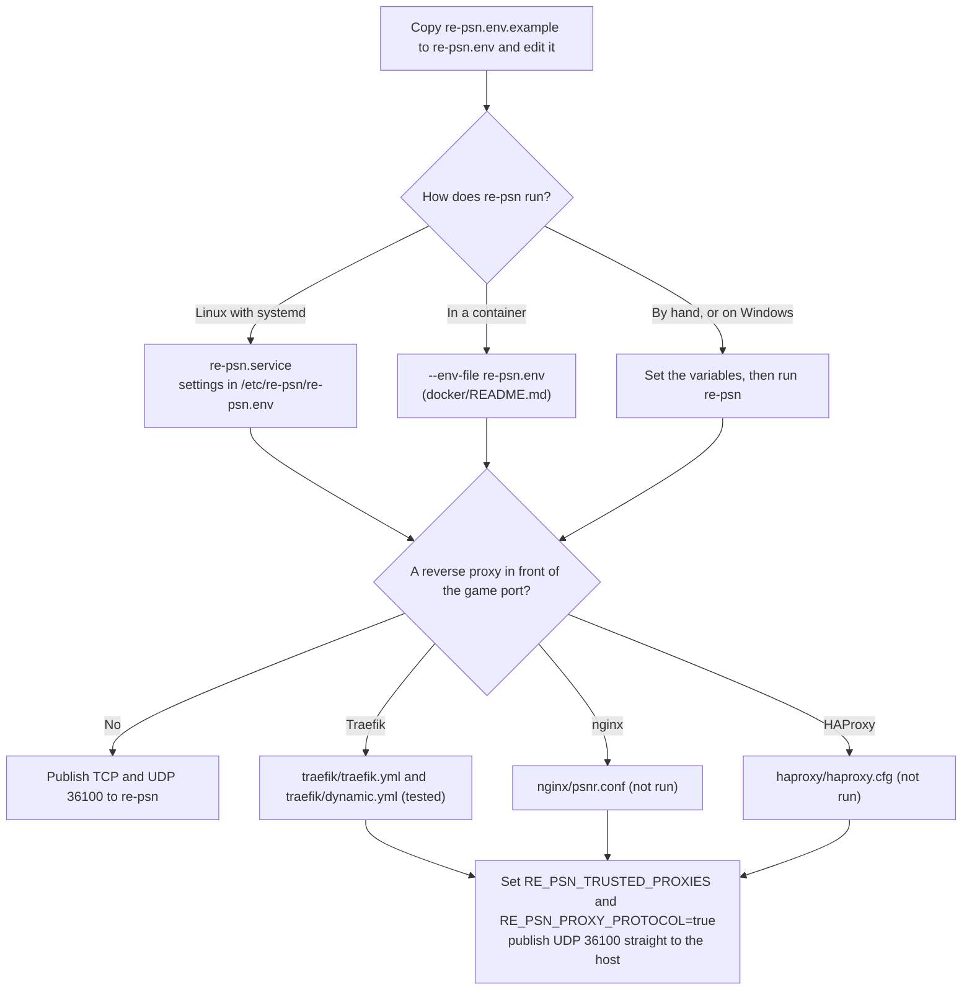
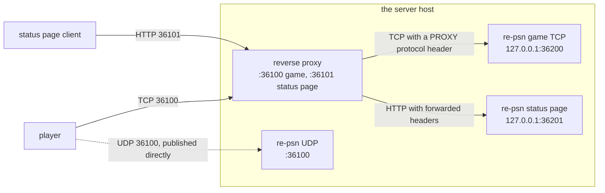

# Deployment examples

Example files for running re-psn as a service and behind a reverse proxy: a settings file, a systemd unit, and Traefik,
nginx, HAProxy and Caddy configs. They are text files; nothing here runs by itself. The release archives carry this folder as
`examples/`. The full text is [docs/running.md](../docs/running.md) in the repository.

## Contents

- [The files](#the-files)
- [Which file to use](#which-file-to-use)
- [Behind a reverse proxy](#behind-a-reverse-proxy)
- [Ports](#ports)

## The files

| File | What it is |
|---|---|
| `re-psn.env.example` | Every setting, commented, with its default, as `RE_PSN_*` variables (the old `PSNR_*` names still work and are listed at the end). Copy it to `re-psn.env` and edit; keep it private. |
| `re-psn.service` | A systemd unit (Linux) for `/usr/local/bin/re-psn`. It reads `/etc/psnr/psnr.env`, then `/etc/re-psn/re-psn.env` (both optional; the second wins), and keeps the state directory `/var/lib/psnr`. |
| `traefik/` | Traefik, a TCP router with PROXY protocol v2. Tested with Traefik 3.1 under Podman. |
| `nginx/psnr.conf` | nginx `stream` with PROXY protocol v1. Not run. |
| `haproxy/haproxy.cfg` | HAProxy with `send-proxy-v2`. Not run. |
| [`caddy/`](caddy/README.md) | Stock Caddy 2 for the HTTP status page only, bound to loopback; game TCP and UDP stay direct. Not run or validated with Caddy. |
| [`fail2ban/`](../docs/fail2ban.md) | Disabled journal/filter example for refused HTTP status tokens, with an offline checker. Host firewall/jail behavior is unverified; game TCP/UDP is outside its scope. |

## Which file to use

Start from the settings file, then add the unit and a proxy config only if you need them:

## Behind a reverse proxy

For the Traefik, nginx and HAProxy game TCP examples, set these on re-psn. The
[Caddy HTTP-only example](caddy/README.md) uses different settings: game traffic stays direct and PROXY protocol stays off.

| Setting | Value |
|---|---|
| `RE_PSN_TRUSTED_PROXIES` | Only your own proxies. `0.0.0.0/0` trusts everyone. |
| `RE_PSN_PROXY_PROTOCOL` | `true` |
| `RE_PSN_TCP_ADDR` | `127.0.0.1:36200` in the proxy examples |
| `RE_PSN_HTTP` | `127.0.0.1:36201` in the proxy examples |

> [!WARNING]
> UDP is not proxied: publish it straight to the host. re-psn checks that a UDP probe comes from the player's TCP address,
> so UDP must reach it with the player's own address (docs/running.md, "UDP source address").

In the proxy examples the proxy owns 36100 (TCP game) and 36101 (status page), and re-psn listens behind it on
`127.0.0.1:36200` and `127.0.0.1:36201`. This is the Traefik example; the nginx example has its status page block commented
out (listening on 8080), and the HAProxy example passes the game port only:

## Ports

Ports in the game TCP proxy examples are the defaults below. Caddy's status-only example binds `127.0.0.1:36101`,
forwards to `127.0.0.1:36201`, and leaves game TCP and UDP directly on re-psn's `:36100`.

| Port | Protocol | Who listens |
|---|---|---|
| 36100 | TCP | the proxy (game), passed to re-psn on `127.0.0.1:36200` |
| 36100 | UDP | re-psn, published directly |
| 36101 | TCP | the proxy (status page), passed to re-psn on `127.0.0.1:36201` |

> [!NOTE]
> If you change a port, change the firewall too.
