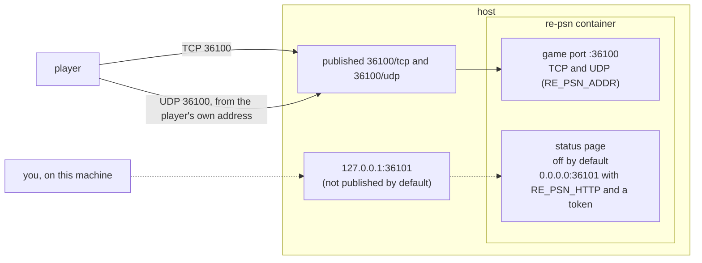
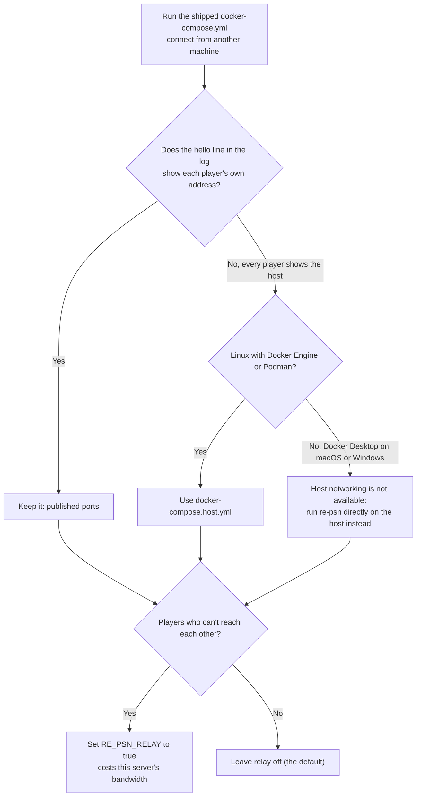
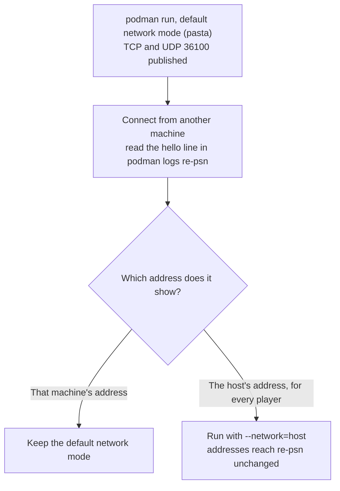
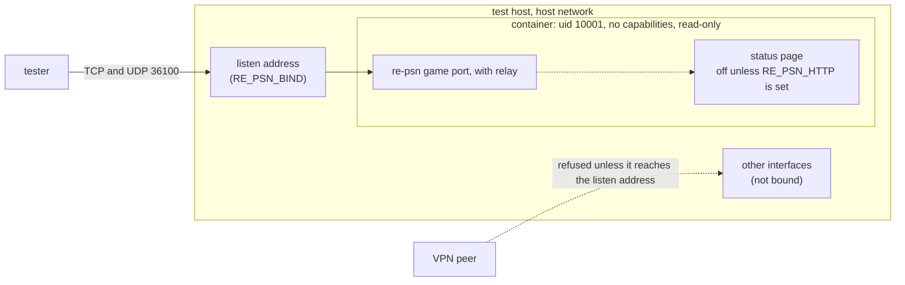

# Running re-psn in a container

How to build the re-psn image from this repository and run it with Docker or Podman, which ports to publish, and how
to set it up. The current image is `ghcr.io/undecuple/re-psn:0.5.0` (0.4.0, 0.3.0 and 0.2.0 are still available), or you build it from this repository.

## Contents

- [The files](#the-files)
- [Build and run](#build-and-run)
- [Ports](#ports)
- [Relay and host networking](#relay-and-host-networking)
- [Podman](#podman)
- [The image](#the-image)
- [The published image](#the-published-image)
- [A shared test host](#a-shared-test-host)
- [Settings](#settings)
- [Behind a reverse proxy](#behind-a-reverse-proxy)
- [The lab](#the-lab)

## The files

| File | What it is |
|---|---|
| `Dockerfile` | A two-stage build: Go 1.26 on Alpine 3.24 in the first stage, Alpine 3.24 with one static binary in the second. Both bases are pinned by digest, and the server runs as user 10001. |
| `docker-compose.yml` | The same, with the ports and a restart policy. |
| `docker-compose.host.yml` | Opt-in, Linux only: the same server on the host's network, with no published ports. |
| `docker-compose.test.yml` | Opt-in, Linux only: the host-network server with a hardened container, for a shared test host. |
| `Dockerfile.dockerignore` | Keeps everything but `go.mod` and `server/` out of the build context. |

## Build and run

From the repository root:

```sh
docker build -f docker/Dockerfile -t re-psn .
docker run --rm -p 36100:36100 -p 36100:36100/udp re-psn

docker compose -f docker/docker-compose.yml up -d      # the same, with the ports and a restart policy
```

The build context is the repository root, not this folder: the Dockerfile copies `go.mod` and `server/` from there. Podman works the same
way (`podman build -f docker/Dockerfile .`).

## Ports

The game port is published for TCP and UDP. The status page is off until you set `RE_PSN_HTTP` (see
[Settings](#settings)); the compose file has the line that publishes it on this machine only, commented:



> [!WARNING]
> re-psn refuses a UDP probe whose source address differs from the player's TCP address
> ([docs/running.md](../docs/running.md#udp-source-address), "UDP source address"). UDP must reach the server with the
> player's own address, so publish it straight to the host, not through a proxy or port forwarder that rewrites the source.

## Relay and host networking

The image is the whole re-psn server, not a relay-only build. Relay is one setting, `RE_PSN_RELAY`, and it is off by default: without
it the server does matchmaking, rooms, scores and address discovery, and carries none of the players' game traffic. Turn it on
(`RE_PSN_RELAY: "true"`, commented in the compose file) to carry traffic between players who can't reach each other directly; that
uses this server's bandwidth.

Host networking is a separate, optional choice about addresses. With the shipped compose file the runtime forwards the published
ports, and on some setups it rewrites each player's source address on the way in. Then re-psn sees every player as the host, and its UDP
source check refuses their probes. `docker-compose.host.yml` runs the container on the host's network (`network_mode: host`, no `ports`), so the real addresses
arrive unchanged:

```sh
docker compose -f docker/docker-compose.host.yml up
```

It works only on Linux, with Docker Engine or Podman. Docker Desktop on macOS and Windows runs containers in a virtual machine, so
the game port would not appear on your machine; use `docker-compose.yml` there. With no `ports` list, the firewall must allow 36100/tcp and 36100/udp,
and the status page must stay on localhost or have a token.



> [!NOTE]
> Tested with rootless Podman 6.1.4 and podman-compose 1.6.0 on Linux (podman-compose puts the service on a bridge network; `podman run`'s default, pasta, passed addresses through in the test under [Podman](#podman)): with `docker-compose.yml` the `hello` line showed the container network's
> address (10.89.0.2) for every player and `client/test_psnr.c` failed its probe check; with `docker-compose.host.yml` it showed 127.0.0.1 and the test passed.
> Both files also pass `docker compose config` (Compose 5.6.0). Not tested: Docker Engine itself, Docker Desktop, macOS, Windows, and players on another machine.

## Podman

The same Dockerfile builds and runs with Podman, rootless included (ports above 1024 need no root):

```sh
podman build -f docker/Dockerfile -t re-psn .

podman run -d --name re-psn --restart=on-failure \
  -p 36100:36100/tcp -p 36100:36100/udp \
  re-psn
```

Add `-e RE_PSN_<FLAG>=value` for any setting, or `--env-file re-psn.env` (copy `deploy/re-psn.env.example` from the release archive's `examples/`, or from
this repository, and keep `re-psn.env` private; the old `PSNR_<FLAG>` names still work). Status page, from this machine only:

```sh
-e RE_PSN_HTTP=0.0.0.0:36101 -e RE_PSN_HTTP_TOKEN=<a long random string> -p 127.0.0.1:36101:36101
```

`podman logs re-psn` shows the log; `podman rm -f re-psn` stops and removes it.

> [!NOTE]
> Tested with Podman 6.1 on Linux: the image builds, a TCP connection to the published port is accepted, the status page answers 401
> without the token and 200 with it, and the restart policy is set. Not tested: compose (`podman compose` needs a compose provider),
> a systemd unit for the container (Quadlet), and Windows or macOS Podman machines.

### Check the address re-psn sees

Rootless Podman forwards published ports itself, and in the test a connection from 127.0.0.1 was logged inside the
container as the machine's own LAN address. re-psn uses the player's address for `-max-conns-per-addr`, the same-name reconnect rule and the address it
tells other players. Connect from another machine, look at the `hello` line in `podman logs re-psn`, and make sure it shows that machine's address and not
the host's; if every player shows the host's address, those features lump everyone together. Running with `--network=host` avoids the
forwarding: there the addresses reach re-psn unchanged.

Choosing the network mode, from that test:



### UDP and the source address check

re-psn refuses a UDP probe whose source address differs from the player's TCP address ([docs/running.md](../docs/running.md#udp-source-address),
"UDP source address"). Tested with rootless Podman 6.1.4 (pasta, the default network mode) and the commands above: a client sending TCP and UDP from one
address was accepted, a client sending them from two different addresses was refused, and `PSNR_UDP_ANY_SOURCE=true` accepted it; the same held with
`--network=host`. Not tested: a client on another machine, a NAT between client and host, slirp4netns, rootful Podman, and Docker.

## The image

The server runs as a non-root user, `re-psn`, uid and gid 10001 (no home, no shell). The game port is above 1024, so it needs no capability.
Compose files can say `user: "10001:10001"`. There is no `HEALTHCHECK`: the image has no tool to probe a port, and the status page is
off by default, so a check would need a new package or a wider status page.

Both base images are pinned by digest (`FROM image:tag@sha256:...`, the multi-arch index digest): `golang:1.26-alpine3.24` (Go 1.26.10 when
this was written; `go.mod` says `go 1.22`, a minimum) and `alpine:3.24`. Dependabot's docker ecosystem updates the tag and the digest
together. The image was built and run with rootless Podman 6.1.4 only (Docker is not installed on the test machine): `podman exec` showed
`uid=10001(re-psn)`, and `client/test_psnr.c` passed against it on the host network. The NAT lab was not run, so `lab/Dockerfile`
still has its own base tag.

## The published image

`.github/workflows/container.yml` builds the image for `linux/amd64` and `linux/arm64` and pushes it to GitHub's container registry as
`ghcr.io/undecuple/re-psn` when a release is published. Tags: `X.Y.Z` for every release; `X.Y` and `latest` only for a release that is
not a pre-release, so while every release is a 0.x pre-release only the exact version tag exists. Before it pushes, the workflow starts
the amd64 image and checks that it reports the version and runs as uid 10001; the arm64 image is built under emulation and not run.

```sh
docker pull ghcr.io/undecuple/re-psn:0.5.0
```

The first image, `0.2.0`, was pushed by a manual run of the workflow (the release it belongs to was tagged before the workflow existed): both
platforms, one manifest list. The image is unsigned, and the workflow switches the provenance and SBOM attestations off, so it is a plain
image. The arm64 image was built under emulation and has not been run. A package under a user account starts private; its visibility is a
setting on GitHub, and the image's source label links it to this repository.

## A shared test host

`docker-compose.yml` and `docker-compose.host.yml` run the container as user 10001 with all capabilities dropped, no new privileges and a read-only root filesystem with a 16 MB tmpfs on `/tmp`. A log file (`RE_PSN_LOG_FILE`) needs a volume then, and a listen port below 1024 cannot be bound.

For a server you do not own outright, such as a shared machine with VPN links, `docker-compose.test.yml` adds hardening to the host-network
setup: the same lines, plus memory, CPU and process limits, no volumes, no published ports, and `restart: "no"`.

```sh
RE_PSN_BIND=192.0.2.10:36100 docker compose -f docker/docker-compose.test.yml up --build
docker compose -f docker/docker-compose.test.yml down
```

`192.0.2.10` is a documentation address; use the address of the interface your testers reach.



> [!WARNING]
> - **Bind an explicit address.** `RE_PSN_BIND` is required and there is no default: the file refuses to start without it. A wildcard such as `:36100` would also answer on every VPN interface.
> - **The relay is on** (`RE_PSN_RELAY`, default `true` here). It carries traffic between any two clients that can reach the server and uses its bandwidth. Set `RE_PSN_RELAY=false` to turn it off.
> - **VPN peers** that can route to the listen address can connect; the firewall must allow 36100/tcp and 36100/udp only to who you intend.
> - **Ports below 1024 fail.** `cap_drop: ALL` also drops `NET_BIND_SERVICE`, so a listen port below 1024 in `RE_PSN_BIND` cannot be bound (36100 is fine).
> - The status page is off unless `RE_PSN_HTTP` is set (`127.0.0.1:36101` is the host's own localhost); set `RE_PSN_HTTP_TOKEN` if you ever bind it wider.

Tested with rootless Podman 6.1.4 and podman-compose 1.6.0, with `RE_PSN_BIND=127.0.0.1:36100`: the container ran as uid 10001, a write to `/`
failed (read-only), `/tmp` was writable, `NoNewPrivs` was 1 and the effective capabilities were empty. `docker-compose config` (Compose v2)
printed the expected file and failed with the message when `RE_PSN_BIND` was unset. `client/test_psnr.c` passed with `RE_PSN_RELAY=false`;
with the relay on, it stops early (it expects no relay push), which says nothing about the hardening. Not tested: Docker, a client on another
machine, a VPN.

## Settings

The image has no fixed flags. Every flag is a `RE_PSN_<FLAG>` environment variable, and the old `PSNR_<FLAG>` still works
([docs/running.md](../docs/running.md#environment-variables), "Environment variables"); the compose
file shows `RE_PSN_ADDR`. If you change a port, change the published port and your firewall too.

### The status page

The status page lists every online ID, so it is off by default. To reach it, bind it inside the container
and set a token, then publish the port on this machine only (the lines are in the compose file, commented):

```dotenv
RE_PSN_HTTP=0.0.0.0:36101
RE_PSN_HTTP_TOKEN=<a long random string>
```

Make the token with a random generator, not by hand. Any of these works (hex and base32 contain only characters that are safe in a `?token=` URL;
base64 can contain `+`, `/` and `=`, which then need URL-encoding):

```sh
openssl rand -hex 32                          # 64 hex characters (256 bits)
head -c 32 /dev/urandom | base32 | tr -d '='  # 52 base32 characters (256 bits), coreutils
openssl rand -base64 32                       # 44 characters, if you send it only as a Bearer header
```

All three were run (OpenSSL 3.5.9 and GNU coreutils) and gave the lengths shown.

> [!WARNING]
> A token set through the environment is visible to `docker inspect` and to other users on the host.

## Behind a reverse proxy

Set `RE_PSN_TRUSTED_PROXIES` to your proxy's address as the container sees it and `RE_PSN_PROXY_PROTOCOL=true`, and have the proxy send PROXY
protocol on the game TCP port. Publish UDP straight to the host. The release archives carry proxy examples in `examples/` (in this repository,
[deploy/](../deploy/README.md)); see [docs/running.md](../docs/running.md#behind-a-reverse-proxy), "Behind a reverse proxy".

## The lab

`lab/run.sh` builds this image and `lab/Dockerfile` (both from the repository root) and runs the NAT scenarios; see
[lab/README.md](../lab/README.md).
