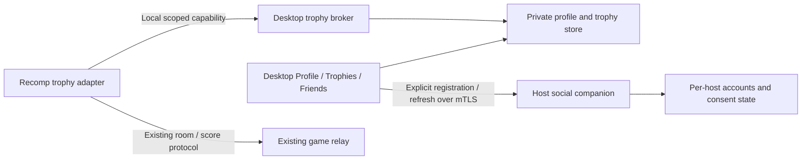

# Desktop profiles, trophies and authenticated friends

The desktop app can own a portable re-psn identity and an offline trophy store. Recomp developers report unlocks
through a small local C SDK. Separately, a player can register the same public identity with explicitly selected
social companions hosted beside relays, and manage a different friend list at each host.

This authenticates control of a re-psn key. Trophy reports are game/player supplied, with a local receipt time;
they do not prove an achievement, game ownership or a PSN account. The examples use invented metadata. This does
not provide Sony authentication, ticket processing, a provider-verification badge or authenticated gameplay HELLO.

## Components



The exported Go package is `github.com/undecuple/re-psn/app/framework`, in the app's Go 1.26 module. Its lifecycle
and protocol reference is [App framework API](app-framework-api.md). The existing
game server module and binary game protocol are unchanged. The social companion is an optional separate app
subcommand, with its own HTTPS listener and private state directory. Starting the ordinary app does not create
an identity, grant a game access or enroll with a social companion.

## Try the local developer path

Build the app and the dependency-free C99 example from the repository root:

```sh
(cd app && go build -o /tmp/re-psn-app ./cmd/re-psn-app)
cc -std=c99 -Wall -Wextra -Werror -Iclient client/psnr_app.c client/examples/app_trophy.c -o /tmp/app-trophy
```

Create a private profile and explicitly approve a catalog. `--dir` names an app-owned private directory, separate
from `re-psn.ini` and game saves. On Unix an existing directory must be private to its owner.

```sh
/tmp/re-psn-app profile create --dir /tmp/demo-profile --name 'Demo player'
/tmp/re-psn-app trophies install --dir /tmp/demo-profile --input client/examples/app_trophies.json
/tmp/re-psn-app profile serve --dir /tmp/demo-profile --title RE-PSN-SDK-DEMO --grant-file /tmp/demo-game-grant.txt
```

Keep that process running. In another terminal:

```sh
/tmp/app-trophy /tmp/demo-game-grant.txt status 1
/tmp/app-trophy /tmp/demo-game-grant.txt unlock 1
/tmp/app-trophy /tmp/demo-game-grant.txt status 1
/tmp/re-psn-app --profile-dir /tmp/demo-profile
```

Select Trophies (`7`, Enter). The first receipt time survives restart and repeated unlocks. Closing the broker
revokes its capabilities and removes its own descriptor. The descriptor contains a secret; give its path to the
game, never its contents in arguments, telemetry or logs. Each capability can query/unlock only one approved title.

The desktop Trophies screen can also issue (`g`) and revoke (`v`) a grant. Keep that app session open while the
game uses its descriptor. One desktop session shares its writer between local game reports and friend actions.
The standalone broker holds the same exclusive writer, so stop it before using other CLI commands that mutate
the profile. Read-only snapshots and trophy views remain available while it runs.

## Recomp developer contract

Vendor [psnr_app.h](../client/psnr_app.h) and [psnr_app.c](../client/psnr_app.c). They are separate from the networking
client and do not require a second `psnr.c` instance. The header supports C++ callers. On Windows link `ws2_32.lib`.
See [app_trophy.c](../client/examples/app_trophy.c) for argument handling and error reporting.

1. Map your runtime's trophy registration/definitions to an explicit app-approved catalog with a stable title ID,
   revision and integer trophy IDs. Use metadata you are entitled to distribute; the app does not extract game assets.
2. Load the explicitly supplied private descriptor using `psnr_app_load_grant`. It accepts a bounded regular file,
   never a caller-chosen network host. Set `timeout_ms` between 1 and 60000 (default 2000).
3. Dispatch `psnr_app_unlock` and `psnr_app_status` outside the engine's frame loop and runtime locks. Calls block
   until a reply or deadline. Deliver the result through your runtime's normal callback queue.
4. Keep your own offline fallback and reconcile unsent events when a fresh grant is available. An unavailable or
   revoked broker is an error, never a fabricated successful unlock. The SDK does not automatically start the app.

The app records unlocks monotonically and idempotently. There is no automatic platinum award, reset, incompatible
catalog replacement, trophy upload or merge from other saves. An adapter must implement the game's own trophy/HLE
semantics; this SDK does not implement Sony trophy container/save formats. The grant cannot read profile keys,
export a profile, change catalogs or access friends. A same-user process that steals a descriptor can report that
title's trophies; this is scoped access, not anti-cheat.

Capabilities expire after 15 minutes. The desktop and `profile serve` renew the active grant every five minutes
while they own it; renewal preserves its title and rate counters. SDK callers cannot renew or resurrect a revoked
or expired grant. After a long sleep or an app restart, issue a new grant and reconcile pending reports explicitly.

## Local broker protocol v1

One request per TCP connection, bound to literal IPv4 `127.0.0.1` on an ephemeral port. All multibyte integers are
big-endian. The client must half-close its write side after exactly 48 request bytes. The broker requires EOF
before mutation, under a two-second deadline; extra bytes or an incomplete request cannot unlock a trophy.

| Bytes | Request |
|---|---|
| 0–3 | ASCII `RPT1` |
| 4 | Opcode: 1 unlock, 2 status |
| 5–7 | Zero reserved bytes |
| 8–11 | Body length: 36 |
| 12–43 | 32-byte capability |
| 44–47 | uint32 trophy ID |

The response has `RPR1`, a one-byte status, three zero reserved bytes and uint32 body length. Status 0 has a
nine-byte body: unlocked byte (0/1), then uint64 Unix **milliseconds** of first receipt (zero if locked). Other
statuses have an empty body: 1 unauthorized/expired, 2 unknown trophy, 3 busy, 4 malformed, 5 storage failure,
6 rate limited. Native SDK errors also distinguish unavailable transport, invalid arguments/replies and timeout.
The SDK uses one absolute network deadline across connect/send/receive; opening a caller-supplied file is separate.

The grant file is ASCII, at most 512 bytes, with exactly these three newline-terminated lines:

```text
re-psn-app-grant-v1
port=12345
token=64-lowercase-hex-digits
```

The broker bounds concurrent connections (16), grants (128), request sizes and per-grant traffic. An app must
serialize revoke with mutation and stop/join the broker before closing its store. The exported broker does this;
callers embedding it must still own its lifecycle and retain the private descriptor only for the active session.

## Portable identity and encrypted recovery

`profile create` generates an Ed25519 key using the OS random source. The public ID is `rp1-` followed by the
64 lowercase hexadecimal digits of SHA-256 of the raw 32-byte public key. Display names are labels, not credentials.
The profile snapshot contains its signing seed, so protect the directory using OS permissions. On Windows choose
a private per-user directory with appropriate ACLs; Unix mode bits do not establish Windows ACL isolation.

For encrypted backup, create a private local passphrase file (12–1024 bytes), then:

```sh
/tmp/re-psn-app profile export --dir /tmp/demo-profile --output /tmp/demo-profile.backup --passphrase-file /private/passphrase-file
/tmp/re-psn-app profile restore --dir /tmp/restored-profile --input /tmp/demo-profile.backup --passphrase-file /private/passphrase-file
```

Outputs are never overwritten. Restore requires a new or empty destination and validates before publishing.
Backups preserve identity and local trophy state, and exclude capability tokens, TLS trust and cached remote
friendship state. Refresh each selected host to obtain its current authority. Restoring cannot undo host revocation
or transfer accepted friendships to another host. There is no federation, password reset, rotation or unban flow.

Backup v1 is `RPSNBAK1`, 16 random salt bytes, 12 random nonce bytes, then AES-256-GCM ciphertext/tag of the bounded
profile JSON. The entire 36-byte header is authenticated associated data. PBKDF2-HMAC-SHA256 uses a fixed 600000
iterations and a 32-byte key; the input cannot select a cheaper or unbounded work factor. A strong passphrase still
matters. This is recovery encryption, not encryption of the unlocked runtime store or protection against same-user
malware, compromised memory or filesystem rollback.

## Host an authenticated friend service

The operator supplies a normal TLS server certificate/key and an explicit allowlist of public IDs received out
of band. An empty allowlist admits nobody. Run the companion directly behind a TCP TLS passthrough if needed;
an ordinary HTTP reverse proxy that terminates TLS cannot forward the client's identity safely to this v1 service.

```sh
re-psn-app account-relay serve --state /private/social-state --listen 0.0.0.0:36443 \
  --tls-cert /private/server-cert.pem --tls-key /private/server-key.pem --allow rp1-ALICE_PUBLIC_HASH,rp1-BOB_PUBLIC_HASH
```

Replace the illustrative IDs with real `profile show` public IDs. The certificate must cover the hostname/IP used
by clients. Use a public CA or distribute a private CA through a trusted channel; there is no insecure-TLS switch,
trust on first use, redirect following or environment HTTP proxy. Trust settings are explicit and separate from
the portable backup. The client authenticates with a self-signed Ed25519 certificate tied to its profile key over
TLS 1.3; the service derives identity from the verified key, ignoring display subjects and request IDs.

Registration is separate from allowlisting and never automatic. For example:

```sh
re-psn-app friends register --dir /private/alice-profile --relay https://relay.example.org:36443 --ca-file /private/host-ca.pem
re-psn-app friends request --dir /private/alice-profile --relay https://relay.example.org:36443 --ca-file /private/host-ca.pem --id rp1-BOB_PUBLIC_HASH
re-psn-app friends accept --dir /private/bob-profile --relay https://relay.example.org:36443 --ca-file /private/host-ca.pem --id rp1-ALICE_PUBLIC_HASH
re-psn-app friends list --dir /private/alice-profile --relay https://relay.example.org:36443 --ca-file /private/host-ca.pem
re-psn-app --profile-dir /private/alice-profile --social-relay https://relay.example.org:36443 --social-ca-file /private/host-ca.pem
```

Omit `--ca-file` for system-trusted certificates. These HTTPS origins have no path prefix, query, credentials or
fragment. The optional trailing slash is canonicalized. The desktop Friends screen requires explicit registration
confirmation (`e`, `y`); `f` requests a peer ID, `a` accepts, `d` declines/cancels, `u` removes, `b` blocks, `x` unblocks
and `r` refreshes. Requests require mutual consent; crossed requests do not silently accept. A block removes accepted
and pending edges in both directions. Unblocking never restores a friendship. Unknown/blocked targets return generic
unavailable responses, and there is no public directory. The screen labels cached snapshots and their fetch time;
there is no live online/title/room presence, invitation or join-a-friend support yet.

The same portable identity can register at another host, but each host independently owns registration, requests,
friendships and moderation. Reusing the key makes registrations linkable across cooperating hosts and peers. Use
a separately created profile when you want an independent identity. A restored local cache cannot grant remote
authority. A `framework.CacheError` means a remote operation succeeded but its local cache failed; refresh rather
than assuming the remote action rolled back. An interrupted response can likewise leave its remote outcome unknown.

The host keeps a private atomic state file containing account IDs/labels, registration/revocation and consent/block
edges. It does not persist peer IPs, login history or game presence. State is bounded to 256 accounts, 64 contacts
per relation set and 4 MiB, with bounded HTTP bodies, responses, connections and rates. Allowlist changes require
a restart. To revoke an account, stop the service first, then use host-local administration:

```sh
re-psn-app account-relay revoke --state /private/social-state --id rp1-REVOKED_PUBLIC_HASH
```

Revocation persists and removes friendships/pending requests in both directions. The embedding Go host can call
`SocialService.RevokeAccount` while serving; admission is checked for each request, including existing TLS sessions.
There is no remote administrator route, hot allowlist reload or revocation reversal. Back up the host state only
while stopped; concurrent processes cannot share a writable state directory.

## Storage and verification limits

Each store has a stable separate OS advisory lock; a process crash releases it. Writes validate a bounded versioned
snapshot, flush a same-directory temporary file, atomically replace the snapshot and sync its directory where
supported. A failure after replacement reports uncertain durability; it is not a promise that the old state remains.
Windows uses an OS replacement operation rather than delete-then-rename. The profile caps 128 catalogs, 1024 trophies
per catalog and 4 MiB aggregate serialized state. Catalog redefinition and malformed/duplicate JSON fields are refused.

The local tests use generated profiles, certificates and synthetic metadata. They cover native C reporting, persistence,
encrypted restore and actual TLS friendship operations across independent hosts. They do not establish compatibility
with a real game, Sony trophy saves, hosted infrastructure, a physical Windows terminal or native Windows C runtime.
Live presence, invites, authenticated gameplay admission, trophy synchronization, OS keychains and a graphical UI
remain separate work. The current desktop app is the terminal UI described in [app/README.md](../app/README.md).
