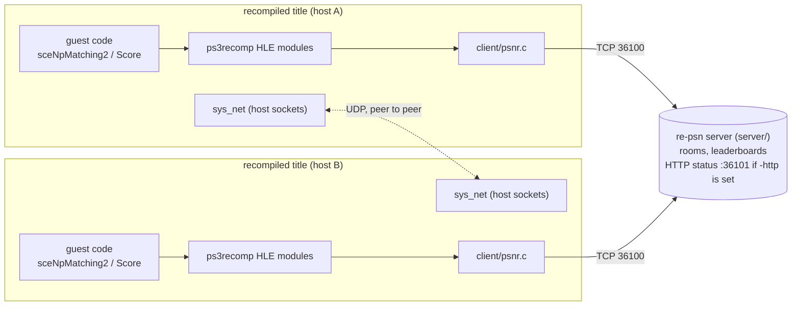
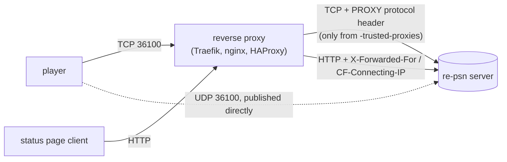
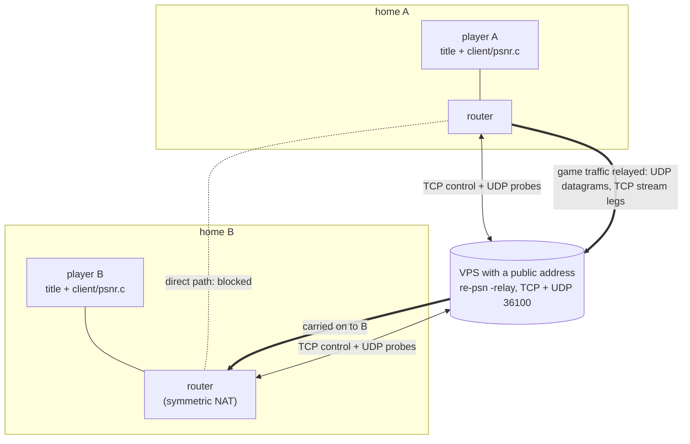
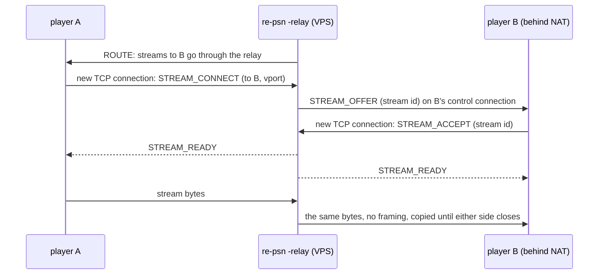

# Architecture

In the current psnr path, the server in `server/` handles rooms, leaderboards and the address hand-out over TCP, the C
client in `client/` runs inside the title, and game traffic goes peer to peer, through the server's relay only when it
has to.

## Contents

- [Overview](#overview)
- [The parts](#the-parts)
- [Planned title-profile-specific Medius frontend](#planned-title-profile-specific-medius-frontend)
  - [Logical sessions across service sockets](#logical-sessions-across-service-sockets)
- [Why the server doesn't carry game traffic](#why-the-server-doesnt-carry-game-traffic)
  - [A relayed connection](#a-relayed-connection)
- [Why rooms and leaderboards first](#why-rooms-and-leaderboards-first)

## Overview

In the psnr path, rooms, leaderboards and the address hand-out go through the server over TCP. Game traffic goes peer to
peer over UDP, and through the server's relay only when two players cannot reach each other directly (`-relay`).

Behind a reverse proxy (optional, off by default; see [running.md](running.md#behind-a-reverse-proxy)), the game's TCP connection passes through
the proxy, which tells the server the player's real address with PROXY protocol. UDP is published straight to the server:

## The parts

**`server/`** (Go, standard library only)
- Owns every room and every leaderboard.
- Runs one goroutine per connection, and one mutex over all state.
- Handlers run under the lock and return the pushes they owe other clients.
  Those pushes are written after the lock is released, so a slow peer socket
  never stalls another client's request.
- Keeps state in memory only (see [running.md](running.md)).

**`client/`** (C, one `.c` and one `.h`)
- Written in C because ps3recomp's HLE libraries are C17 and will vendor it.
- **Has no threads.** `psnr_send` returns a request id, and replies and pushes
  come out of `psnr_poll`. Receiving does not wait for new data, but sends and
  automatic heartbeat writes can wait for socket writability. See the
  [integration guide](integrating.md#own-the-client-and-every-returned-message) for owner/callback scheduling.
- The design follows how ps3recomp already delivers asynchronous events. For
  example, `cellSysutilCheckCallback` drains a queue on the guest thread that
  calls it. An NP module sends when the title starts a request, and drains
  `psnr_poll` from the title's own poll or callback call, so the title's
  callbacks run on the thread it expects. A background reader thread would
  need a second queue and a lock to get to the same place.

## Planned title-profile-specific Medius frontend

This is a future boundary, not an implemented service. The existing psnr frontend and its C client keep their present
behavior. A separate, explicitly enabled Medius-compatible frontend would handle framing, profile and service state,
then translate only evidenced operations into domain operations. The domain boundary would own session, membership and
authorization invariants rather than exposing psnr handlers as a presumed Medius protocol. This is a design direction,
not a claim that the current server is already split into independent layers.

Profiles are selected explicitly for a particular title and build; the frontend is off by default. Unknown or
unsupported profiles, versions, application IDs and messages must cause explicit failure, not a generic success or
fallback. If a wire field's layout is unknown, it cannot be claimed as validated. The only allowed TicketLogin is the
unauthenticated synthetic local envelope in the [scope](../ROADMAP.md#scope); it cannot establish a PSN identity or
entitlement. SVO is not part of re-psn and would require a separate companion decision.

### Logical sessions across service sockets

A future Medius logical session may span discovery, session/login and lobby sockets, and possibly a data connection.
The sockets have distinct service roles and states; a socket is not itself a player identity or a complete session.
Any cross-socket association needs profile and application isolation, bounded lifetimes and resources, scoped
authorization, and explicit transfer, replay and cleanup rules. Local or private addressing is not authentication.
The actual service order and transfer rules remain unknown.

Medius worlds, parties and memberships are not assumed to be equivalent to psnr rooms. No reuse of psnr NAT traversal,
relay or a DME data path is promised: the required data plane and its authorization must first be established for the
profile. The [Medius scope and profile](medius-scope.md) separates source observations from assumptions and unknowns.

## Why the server doesn't carry game traffic

The psnr path follows xlive's model: the relay handles discovery, and the game traffic
itself goes peer to peer.

- Each room member entry carries the peer's address as the server sees it,
  plus the P2P port the peer announced in HELLO.
- The title's signaling layer connects to that address directly over
  `sys_net` sockets.

A relay for game traffic adds a hop of latency to every packet, and it needs a server large enough to carry all of it. So the server
relays only when asked to (`-relay`) and only for players who cannot reach each other any other way.

The cost is NAT. Players behind routers first try to reach each other directly: each sends UDP PROBEs to the server so it learns the router's public
address and port, then both sides send PUNCH packets to open their routers (see "UDP" in [api.md](api.md)). A player behind a router that picks a new
port for every destination (symmetric NAT) cannot be reached that way. With `-relay` the server then carries that player's traffic; without it
the players need port forwarding or a shared VPN (Tailscale works).

### A relayed connection

The example: the host runs re-psn with `-relay` on a VPS with a public address. Players A and B are in different homes, each behind a router, and B's
router is a symmetric NAT. The control connection (rooms, leaderboards) always goes to the VPS. A direct path is tried first; when it fails, game
datagrams and streams are carried by the VPS, which costs the VPS's bandwidth.

How a relayed stream is set up (a player behind a router cannot accept an incoming connection, so both sides connect out to the VPS):

Both players must share a room, and B has 10 seconds to accept.

## Why rooms and leaderboards first

These are the two services that show up across the recompiled library:

- **Rooms:** sceNpMatching2 is the multiplayer path for Simpsons Arcade, You
  Don't Know Jack, and the Sonic/Gunstar Genesis hub.
- **Leaderboards:** sceNpScore is used by about twelve surveyed titles,
  including Crazy Taxi.

Titles whose online play ran on their own servers need a stand-in for that
server, not for PSN; these publisher servers are outside this project's scope:

| Server | Titles |
|---|---|
| Demonware | Guitar Hero III |
| GameSpy | Marvel Ultimate Alliance, Saints Row 2 |
| EA | Orange Box, Trivial Pursuit |

Some titles also use Medius or DNAS. Only the narrow, opt-in Medius profiles described above are in scope; DNAS remains
excluded. A title that requires DNAS, a real PSN ticket, a publisher service or a real secret cannot be supported under
this scope.

The psnr protocol is modelled on the SDK's concepts, not its structs:

- Matching2 bin attributes travel as opaque `external`/`internal` blobs.
- Error codes are the server's own. The client maps them to whatever SDK error
  the title expects.
- The server never needs an SDK header, and a change in how one title packs its
  room data doesn't touch it.
