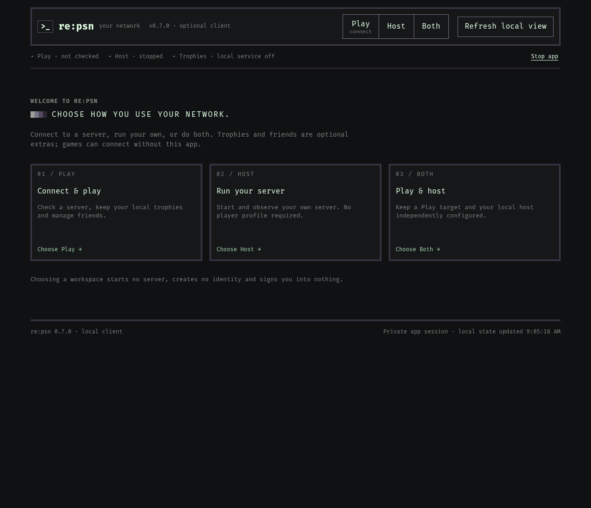
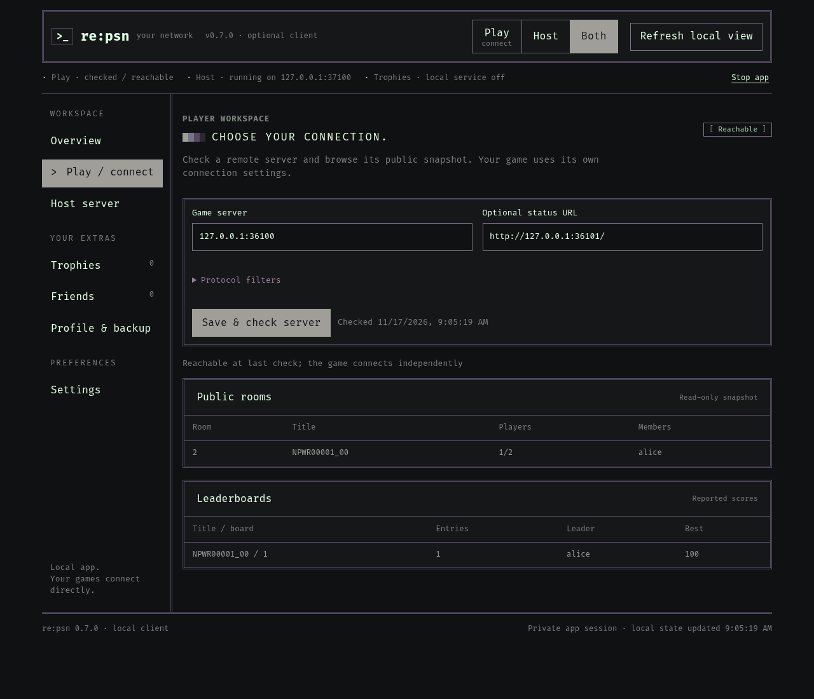
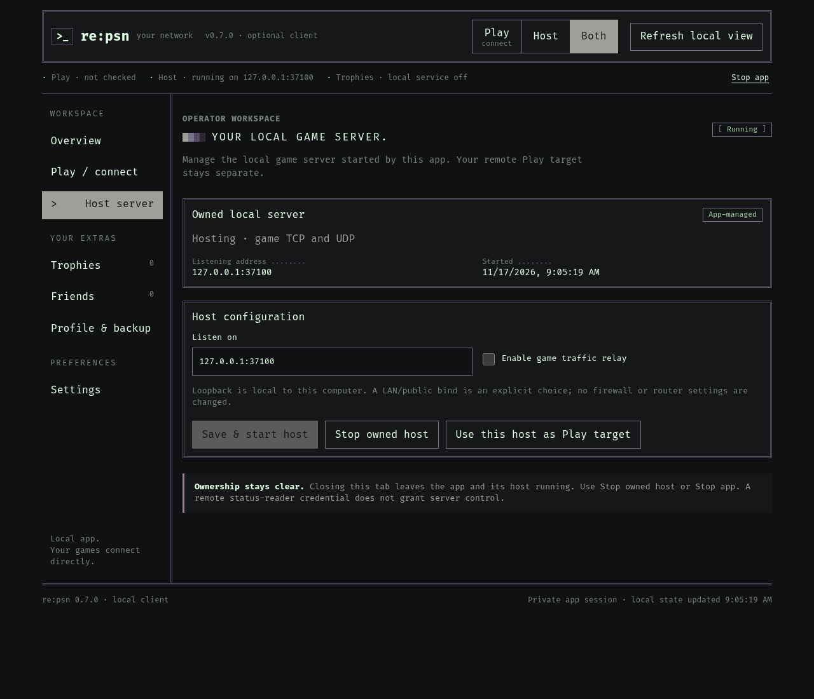
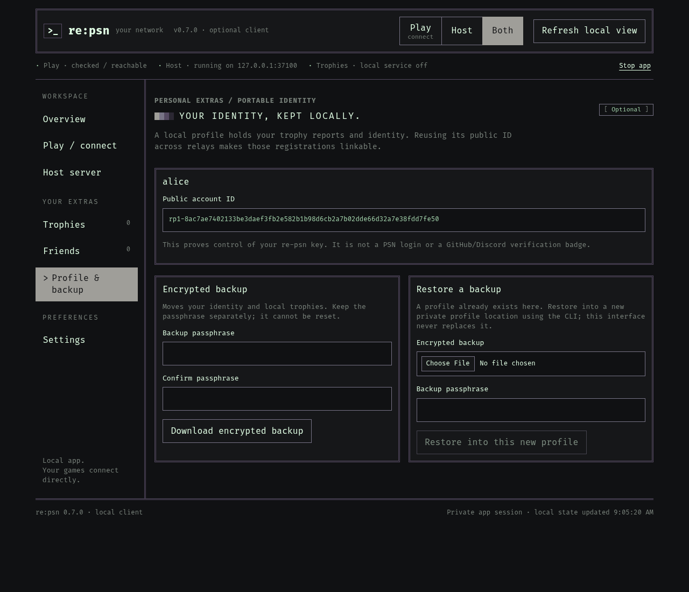

# Optional desktop client

Run `re-psn-app` or `re-psn-app ui` to open the Windows/Linux client in your browser. The app serves its own
interface on a private loopback address; no website account, frontend package manager or external asset is needed.
Its dark colors, local monospace fonts, compact metadata and double frames follow
[undecuple/me](https://undecuple.github.io/me/). Settings also offers Light and System appearance.

Release archives also hold `re-psn-window`, which shows the same interface in a window of its own: see [The native window](#the-native-window). This guide describes the current source. Published app archives can predate this interface and its paired host
component. Games still connect directly to the standalone server without this app, a profile or a friend account.

## Choose a workspace



| Workspace | What it does |
|---|---|
| **Play / connect** | Select/check a remote game server, inspect public snapshots and use optional local trophies/friends. |
| **Host** | Configure a local game bind/relay and explicitly start or stop the server owned by this app. No player identity is required. |
| **Both** | Keep those two configurations independent. An explicit action can set the Play target to your local host. |

Selecting a workspace or saving settings starts no host, trophy broker or registration. Local-only trophy setup does
not need a remote server. Role-appropriate controls stay separate; a successful check is labeled reachability, not a
live game session. The app does not change a recomp's networking files or launch/join a game for you.

## Play and read-only snapshots



Enter a game `HOST:PORT` and optionally the server's HTTP status URL. Choose **Save & check server** explicitly.
Protocol filters let you select a title/leaderboard; an HTTP source supplies its public room and board summaries.
The result records when the check completed. It closes the protocol connection afterward.

The ordinary game protocol does not report every field shown by `/api/stats`. A status source can fail independently
of game reachability; a failed check retains its explanation. Invite-only room details stay private. A status-reader
credential never grants host control. See [native status configuration](../app/README.md#optional-native-http-status).

**Refresh local view** reads the local controller/profile state. It does not automatically check the remote game
server or refresh a friend relay. Those network actions have their own explicit controls.

## Saved servers

Below the Play target, **Saved servers** is a list you keep yourself. Add a name, a game `HOST:PORT` and optionally a status
URL; the list holds at most 64 entries. **Check** asks one server, **Check all** asks every entry (a few at a time, up to
five seconds each, after a confirmation that says how many), and **Use** copies an entry into the Play target above, which
you then save and check as usual. **Export list** downloads the list as a small JSON file.

Nothing is contacted until you press a check button. The app never fetches a list from anywhere, and there is no central
directory. Entries on a loopback, private or link-local address (for example `192.168.0.5:36100` or `localhost`) carry a
"local network address" tag, so you can see when a check would reach inside your own network. A check shows reachable or
not, when it ran and how many public rooms it saw; those results are kept in memory only. A check never sends the Play
status-reader token, and **Use** forgets that token file when the status URL changes, as saving settings does. A status URL
that answers with a redirect counts as unavailable: it is not followed.
A check that is cut short (you close the page) records nothing, so it never replaces an earlier result. Stopping the app waits
for a running Check all to finish, which takes at most five seconds per server in the batch.

The list is stored in `servers.json` beside `re-psn.ini` (private, mode 0600, replaced atomically). If that file cannot be
read, the panel says so and leaves the file as it is. Names are shown as plain text.

## Own a local host



Keep the app's matching `re-psn-host` component beside it (`re-psn-host.exe` on Windows). In Host, choose a literal
IP and port, such as `127.0.0.1:36100`, optionally enable relay traffic and choose **Save & start host**. A LAN/public
bind asks for confirmation; the app makes no firewall or router changes.

The controller starts its trusted component with bounded, fixed settings and checks its private authenticated status
source. Port conflicts and startup failures are errors, not permission to replace another server. The browser cannot
select arbitrary executables/arguments or control a remote server. Advanced source setups can explicitly select a
trusted compatible component through `ui --server-binary PATH`.

**Stop owned host** disconnects its players and ends that child only. Its current rooms/scores use memory storage and
are lost when it stops; local profile/trophy data is separate. Independently started `re-psn` servers remain untouched.
Both keeps the remote Play address separate from the host bind; switching to Play while hosting requires stop confirmation.

For explicit terminal-managed hosting without the browser:

```sh
re-psn-app host serve --listen 127.0.0.1:36100
```

It runs until that controller stops. It needs the trusted server component, not a player profile or account.

## Local trophies

In **Profile & backup**, explicitly create a local profile. In **Trophies**, choose a developer catalog JSON file,
review it and approve it. The backend validates the original document, including duplicate/unknown fields and quotas.
The repository supplies invented examples, not extracted trophy assets.

Select a title and enable game reporting. Give the private descriptor **path** to the recomp's
[trophy SDK adapter](app-framework.md#recomp-developer-contract), never its token contents. The running app renews its
active grant; revoke it or stop the app when finished. Only that profile/title can be queried/unlocked through it.
The runtime must retain its offline fallback and reconcile pending reports after a disconnect, long sleep or new grant.

Reports are monotonic/idempotent local records with a first receipt time. They are game/player supplied, not verified
PSN achievements. There is no automatic platinum, Sony trophy-save importer or remote trophy synchronization.

## Authenticated friends

In Settings, choose the explicit HTTPS origin of a friend companion and, if needed, a trusted local CA file. Saving
settings contacts nobody. Register explicitly in Friends; the host must allow your public identity. There is no
insecure TLS bypass, automatic enrollment or public account directory.

Send a request using the other player's public account ID. Incoming, sent, accepted and blocked lists expose their
appropriate actions. Only the recipient accepts a pending request. Removing/blocking clears the relationship;
unblocking never restores consent. **Refresh from relay** checks remote state; cached snapshots show their fetch time.
Online presence, invitations and join-a-friend are not provided.

The same portable identity can register at several hosts. This makes those registrations linkable; each host still
owns its own registration, moderation and friendship consent. Importing local data cannot recreate another host's
approval or accepted friendships. Key control is not a PSN login or a GitHub/Discord verification badge.
Operators can run the separate [TLS friend companion](app-framework.md#host-an-authenticated-friend-service);
the Host game-server button does not automatically start it.

## Backup and restore



Profile & backup downloads an encrypted recovery bundle using a long, unique passphrase. Keep the passphrase
separately; no server can reset it. The fields clear after the action. The bundle carries your identity/local trophies,
not remote authority, CA trust or live game grants.

Restore is available only for an empty selected profile. It does not replace/merge an existing profile. Use
`ui --profile-dir DIR` or the [CLI recovery commands](app-framework.md#portable-identity-and-encrypted-recovery)
for a separate private location. Stop the controller for that settings file before changing its profile, or select
a separate `--config FILE` for another session. After restore, explicitly authenticate with each relay to fetch its
current state.

## Close, reopen and stop

**Closing a browser tab does not stop the app or its owned host.** Run the same app again to reopen the controller
without duplicating the host. An authenticated local exchange creates a fresh one-use launch link. Explicit profile
or server-component selections that do not match the running controller are refused rather than silently ignored.

Use **Stop app** to stop its owned server, revoke local game reporting and close the controller. Process Ctrl+C also
shuts down what that process owns. The advanced `re-psn-app tui` interface has terminal controls for the same roles;
quitting that terminal controller stops its own host. Neither controller gains authority over an independently started server.

## The native window

`re-psn-window` (`re-psn-window.exe` on Windows, in the app archives next to `re-psn-app`) shows the same interface in a
window of its own, with no tabs or address bar. It is a small [Tauri](https://tauri.app/) program in `app/shell/`: it
starts `re-psn-app ui --no-open --exit-with-parent` from its own folder (and nothing else; any `re-psn-app ui` flags it
is given, such as `--config` or `--profile-dir`, are passed on), reads the private one-use launch link from a new private file, shows it in the system web view and deletes the file. The interface, its token
exchange and its limits are those of the browser version.

- **Closing the window stops the app**, like **Stop app**: the window closes the app's standard input, the app stops what
  it owns, and the window waits 8 seconds before it ends the app by force. If the window program itself dies, the
  closed input stops the app too. If the app stops on its own (**Stop app**), the window closes.
- **Starting it:** with `re-psn-window` beside it, `re-psn-app` (or `re-psn-app ui`) opens the window and passes its flags on, so
  one command opens the same app everywhere. `--browser` opens a browser tab instead; `--no-open` and `--url-file` keep their
  headless meaning. If the window program ends with an error within 5 seconds (no web view installed, no display), `re-psn-app`
  says so and opens your browser instead. The install scripts put `re-psn-window` beside the app.
- Running a second `re-psn-window` while one is open opens another window onto the same app; closing it leaves the app
  running.
- It needs the system's web view: WebKitGTK 4.1 on Linux (for example `libwebkit2gtk-4.1-0`), the WebView2 runtime on
  Windows (part of Windows 10 and 11). Without it, `re-psn-app` still opens in your browser.
- It keeps no settings, profile or credentials of its own. The system web view is Chromium (WebView2) on Windows and
  WebKit on Linux, so small differences in how a page looks or behaves are possible and have been checked on Linux only.
- It is not signed. Building it: [BUILDING.md](../BUILDING.md).

## Private launch and local data

Normal browser dispatch receives a private temporary HTML document instead of a credential-bearing process argument.
Its bootstrap link expires after one minute and can be exchanged only once. JavaScript removes the URL fragment
before exchanging it for a separate API capability kept in memory/sessionStorage, not cookies or localStorage.
The default launch does not put that persistent capability or the bootstrap in process arguments.

Temporary launch-document cleanup is scheduled after 90 seconds. An interrupted or short-lived launcher can leave
an expired private document; its bootstrap remains expired/spent. On Windows, Unix mode bits alone do not establish
private ACLs, so keep app data in the normal private per-user locations.

The local bridge accepts its exact loopback authority and authorized same-origin actions only. Profile keys and
friend TLS signing remain in the backend, not browser storage. Appearance preferences contain no credentials.
No remote scripts, fonts or game assets are loaded. This is a local control surface, separate from a hosted
[read-only status page](running.md#status-page-appearance).

Advanced automation can use a new private file for a short-lived launch link:

```sh
re-psn-app ui --config /private/re-psn.ini --profile-dir /private/profile \
  --no-open --url-file /private/new-launch-link.txt
```

Keep that file private. Ordinary diagnostics show only the loopback base, not a launch credential. A new instance
uses the selected settings location; reopening uses the existing controller for that location.

## Install and update

App archives built from this source contain both the app and its matching host component. Keep them together; do
not rename the component to overwrite an independent standalone server. The current `--app`/`-App` installers check
the archive against SHA256SUMS and require both members. Older app archives without `re-psn-host` are refused.
The historical pinned installer examples for older releases describe those older scripts, not this paired update path.

Stop the app and its host before updating. Both executables are staged first; reported replacement failures trigger
best-effort rollback. **Two flat files are not a crash-atomic update.** If rollback fails, the installer preserves
recovery files and a lock and reports their location. Inspect/recover manually; do not blindly remove a stale lock.
Metadata and optional PATH changes are separate, so the entire installer is not transactional. It never starts,
stops or kills a process for you. A separately installed `re-psn` is preserved.

## Platform evidence

Windows-amd64 and Linux-amd64/arm64 binaries are built. The Windows app uses a GUI subsystem for normal browser
launch; terminal development can use a console build. Linux synthetic browser, owned-host and SDK workflows are
exercised separately from cross-builds and real-title support.

Windows PE controller/profile/SDK/reopen checks under Wine are **Wine evidence, not native Windows evidence**.
The tested Wine environment rejects the server's UDP setup with `WSAIoctl` error 10045, including outside the app
manager. Production UDP checks were retained; native Windows hosting is not established by that Wine run. Physical
Windows desktop behavior, native Windows game/runtime compatibility, ARM64 execution and hosted deployments are
not inferred from compilation or a Linux/Wine synthetic check.
