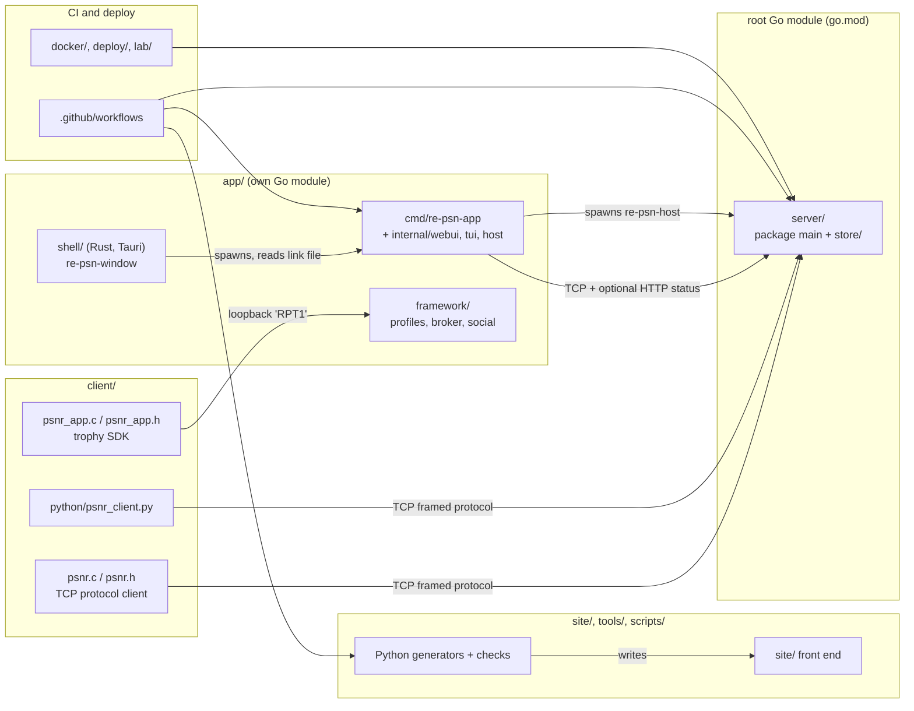
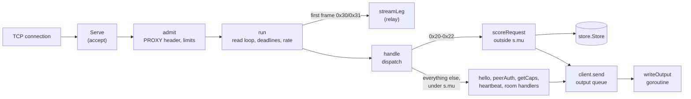
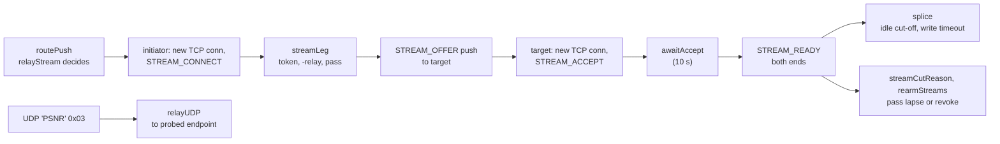
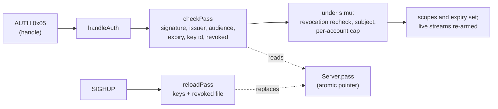
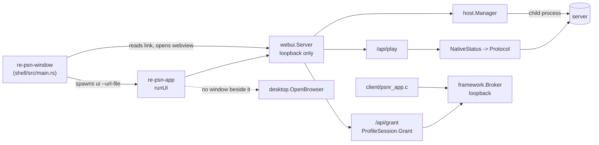
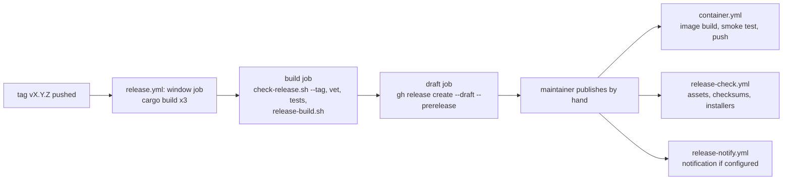
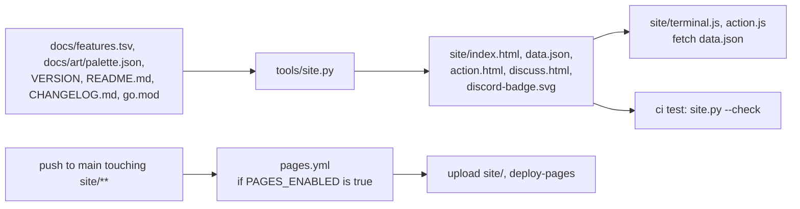

# Code map

A maintainer's map of where things live in this repository (unofficial fan work), read at version 0.9.0. It says which
file or symbol owns which job, how a request moves through the server, and which command or CI job runs which test.
It is a pointer, not a description of behaviour: for the parts and the design reasons see [architecture.md](architecture.md),
for the wire format see [protocol.md](protocol.md), and for the contributor workflow see [developers.md](developers.md).
Line numbers are for the 0.9.0 sources and drift; the symbol names are the stable handle.

## Contents

- [Layers](#layers)
- [Server (`server/`)](#server-server)
- [C and Python clients (`client/`)](#c-and-python-clients-client)
- [Desktop app (`app/`)](#desktop-app-app)
- [Site, tools and scripts](#site-tools-and-scripts)
- [CI and deploy](#ci-and-deploy)
- [Entry points](#entry-points)
- [Data and control flow](#data-and-control-flow)
- [Build and test map](#build-and-test-map)
- [Not covered](#not-covered)

## Layers

## Server (`server/`)

One Go `package main` plus the `server/store` subpackage (`go.mod:1`, `server/scores.go` imports the store). All state
sits behind one mutex (`Server.mu`, `server/server.go:80`); the score store has its own lock.

| Area | Files and symbols |
| --- | --- |
| Entry and flags | `server/main.go` `main` (:25); flag defaults from the environment in `server/config.go` (`envStr`, `envInt`, `envBool`, `lookupSetting`); `var version` at `server/main.go:23` |
| Core and TCP | `server/server.go`: `Server`, `NewServer`, `Serve` (accept loop), `admit`, `run` (per-connection loop), `handle` (dispatch), `hello`, `register` |
| Wire framing | `server/proto.go`: message constants, `readPacket`, `writePacket`, `reader`/`writer`. Feature messages live beside their code (`server/caps.go`, `server/peerkey.go`, `server/pass.go`, `server/relay.go`) |
| Rooms | `server/rooms.go`: `createRoom`, `searchRooms`, `joinRoom`, `leaveRoom`, `setRoomData`, `roomMessage`, `kick`, `setRoomAccess`, `joinByCode` |
| Scores | `server/scores.go`: `scoreRequest`, `recordScore`, `getRanking`, `getRankingByID`; backend in `server/store/store.go` (interface, `Open`), `server/store/memory.go` (the only backend; a planned prefix such as `postgresql://` returns `NotBuiltError`, any other setting `ErrUnknown`) |
| Relay | `server/relay.go`: `relayStream`, `routePush`, `streamLeg`, `awaitAccept`, `splice`, `relayUDP` |
| UDP | `server/udp.go` `serveUDP` (probe, discovery, relay); `server/udp_guard.go` `udpLimiter`; `server/discover.go` `discoverUDP` |
| Sign-in pass | `server/pass.go`: `checkPass`, `handleAuth`, `loadPassKeys`, `reloadPass`, `passAllows` |
| Caps, peer keys | `server/caps.go` `capsFor`, `getCaps`; `server/peerkey.go` `peerAuth`, `peerKeyPush` |
| Output queue | `server/output.go`: `clientOutput`, `send`, `writeOutput` (bounded, non-blocking) |
| Proxy, logging | `server/proxy.go` (PROXY v1/v2, `-trusted-proxies`); `server/logging.go` (`log/slog`) |
| Lifecycle | `server/lifecycle.go` (`Shutdown`, `ready`); `server/replace.go` (pid file, `listenGame`, `-replace`); `server/proc_linux.go`, `server/proc_other.go`, `server/sys_unix.go`, `server/sys_windows.go` |
| Status HTTP (`-http`) | `server/api.go` (`HTTP()`, `/healthz`, `/api/stats`, `authorized`); `server/status.go` embeds `status.html`, `status.css`, `status.js` and builds the CSP; `server/titles.go` + `server/titles.tsv` |
| Admin HTTP (`-admin`, experimental, read-only) | `server/admin.go`: `newAdminServer`, `handler`, `/admin/v1/state` |
| Medius (`-medius`) | `server/medius.go`: a listener that accepts and closes every connection; no Medius protocol is implemented |

## C and Python clients (`client/`)

| Part | Files |
| --- | --- |
| Protocol client (C, no threads) | `client/psnr.c`, `client/psnr.h`. Groups: connect and poll (`psnr_connect`, `psnr_send`, `psnr_poll`, `psnr_call`), decoders for rooms and scores, relay (`psnr_stream_connect`, `psnr_stream_accept`, `psnr_relay_wrap`), discovery (`psnr_discover`), sign-in (`psnr_auth`) |
| Trophy SDK (C) | `client/psnr_app.c`, `client/psnr_app.h`: `psnr_app_load_grant`, `psnr_app_unlock`, `psnr_app_status`. Independent of `psnr.c` |
| Python client | `client/python/psnr_client.py` (`Client`); stdlib only; no relay, UDP probe, pass or peer-key support (docstring, :3-4) |
| Examples | `client/examples/minimal.c`, `client/examples/app_trophy.c`, `client/examples/app_trophies.json` |
| Library build | `client/Makefile`, `client/CMakeLists.txt` (both build the static `libpsnr` from `psnr.c` and `psnr_app.c`; neither defines tests) |

## Desktop app (`app/`)

`app/` is its own Go module (`app/go.mod:1`), separate from the standard-library-only server module.

| Part | Files and symbols |
| --- | --- |
| CLI | `app/cmd/re-psn-app/main.go` `run` (dispatch: ui, tui, host, check, profile commands); `ui.go` `runUI`, `runHost`; `window.go` `delegateToWindow`; `framework.go` `runFramework` |
| Local web controller | `app/internal/webui/server.go` (`Server`, `handle`, `setupDone`, embedded `assets/`: `index.html`, `app.js` with `setupSteps`, `ageWords`, `roomsNote`, `failureHints`, `copyText`, `inviteKind`, `inviteLoopbackOnly`, `inviteWanted` and `renderSetup`, `app.css`), `actions.go`, `serverlist.go`, `invite.go` (`buildInvite`, the injectable `addrLister`) |
| Terminal UI and shared services | `app/internal/tui/` (`ProfileSession` in `profile.go`; `Fetcher`, `Protocol`, `NativeStatus` in `status.go` and `http_status.go`) |
| Game-protocol client | `app/internal/client/` (`Dial`, `Hello`, `SearchRooms`, `Ranking`, LAN discovery) |
| Owned server child | `app/internal/host/host.go` (`Manager.Start` runs the sibling `re-psn-host` with fixed hardening flags) |
| Single instance | `app/internal/appinstance/instance.go` (`Acquire`, `Reopen`) |
| Settings, server list | `app/internal/config/` (`re-psn.ini`), `app/internal/servers/` (`servers.json`) |
| Browser fallback | `app/internal/desktop/browser.go` (`OpenBrowser`) |
| Framework | `app/framework/`: `store.go` (profiles, trophies), `broker.go` (loopback `RPT1` broker), `archive.go` (encrypted export), `social_client.go` and `social.go` (HTTPS mutual-TLS friends) |
| Native window | `app/shell/` (Rust, Tauri 2; `src/main.rs`); shipped as `re-psn-window` per `scripts/release-build.sh` |
| Packaging | `app/share/applications/re-psn.desktop` |
| Integration test | `app/integration/framework_test.go` |

## Site, tools and scripts

- `tools/*.py` generators write checked-in outputs, and each takes `--check` to compare bytes: `tools/site.py` (the
  five `site/` files), `tools/features.py` (`docs/features.md` from `docs/features.tsv`), `tools/badges.py`
  (`docs/img/badges/`), `tools/project_facts.py` (`docs/project-facts.svg`), `tools/art/make_art.py` (`docs/img/*.png`
  and `tools/art/art.json`).
- `site/` holds the hand-written front end (`terminal.js`, `action.js`, `discuss.js`, `nav.js`, `style.css`,
  `favicon.svg`); the pages and `site/data.json` are generated.
- Checkers: `tools/repo_check.py` (tracked layout, links; policy in `tools/repo_layout.json`),
  `tools/check_conformance.py` (requires named Go tests to pass), `tools/loopback.py`, `tools/check_fail2ban.py`.
- `scripts/`: `bump-version.sh`, `check-release.sh`, `release-build.sh`, `release-notes.sh`, `build-appimage.sh`,
  `check-deploy.sh`, `install.sh`/`install.ps1` with their tests, `test-shell-window.sh`.
- `setup.sh` and `Setup.cmd` build the server and write a launcher; `flake.nix` defines only a dev shell.

## CI and deploy

| Piece | Where |
| --- | --- |
| Main CI | `.github/workflows/ci.yml`: jobs `test`, `app`, `shell`, `govulncheck`, `secrets`, `nat-lab` |
| Static analysis | `.github/workflows/codeql.yml` |
| Release draft | `.github/workflows/release.yml` (tag push; creates a draft pre-release, never publishes; a manual run is a build-only dry run) |
| After publish | `.github/workflows/release-check.yml`, `release-notify.yml`, `container.yml` |
| Pages | `.github/workflows/pages.yml`: a build job that uploads `site/` and a separate deploy job (only when the repository variable `PAGES_ENABLED` is `true`) |
| Container | `docker/Dockerfile` (two-stage, non-root uid 10001); compose variants in `docker/` |
| Examples | `deploy/` (env file, systemd unit, proxy configs, fail2ban); nothing there runs by itself |
| NAT lab | `lab/run.sh`, `lab/docker-compose.yml`, `lab/router.sh`, `lab/natcheck.c` |

## Entry points

| Entry | Location |
| --- | --- |
| Server binary | `server/main.go` `main` |
| TCP, UDP, status, admin, Medius loops | `Server.Serve` (`server/server.go`), `Server.ServeUDP` (`server/udp.go`), `Server.HTTP` (`server/api.go`), `adminServer.Serve` (`server/admin.go`), `mediusListener.Serve` (`server/medius.go`) |
| Reload on SIGHUP | `Server.reloadPass` (`server/pass.go`), `adminServer.reload` (`server/admin.go`), wired in `server/main.go` |
| App binary | `app/cmd/re-psn-app/main.go` `main`; subcommands `ui` (default), `tui`, `host serve`, `check`, profile commands |
| Native window | `app/shell/src/main.rs` `main` |
| C API | `client/psnr.h`, `client/psnr_app.h` |
| Python client | `client/python/psnr_client.py` `Client` and its `__main__` block |
| Generators and checks | `tools/site.py`, `tools/features.py`, `tools/badges.py`, `tools/project_facts.py`, `tools/art/make_art.py`, `tools/repo_check.py`, `tools/loopback.py` |
| Release | `scripts/release-build.sh`, `scripts/check-release.sh`, `.github/workflows/release.yml` |
| NAT lab | `lab/run.sh` |

## Data and control flow

### Main request path

`Serve` (`server/server.go`) wraps each accepted socket and runs `admit`, which reads an optional PROXY header
(`server/proxy.go`), applies per-address, total and unauthenticated limits, and creates the `client`. `run` reads frames
with `readPacketLimit` (`server/proto.go`), diverts a connection whose first frame is STREAM_CONNECT or STREAM_ACCEPT
to `streamLeg`, and applies the request rate. `handle` answers ERROR 7 for any request before HELLO, sends score
requests to `scoreRequest` without holding `s.mu` (`server/scores.go`, 2 s store timeout), and runs the rest in one
switch under `s.mu`. Handlers return pushes for other clients; `flush` queues them while the lock is held, and all
writes go through `client.send` into the bounded queue in `server/output.go`.

### Relay path

Relaying is opt-in (`-relay`). `relayStream` (`server/relay.go`) decides per pair whether a viewer is told to use the
relay (never under `-no-peer-titles`, always under `-relay-force`, otherwise only when the target has probed, sits behind a NAT and is not on the viewer's
network; all of it needs `-relay`). The client side is `stream_leg` in `client/psnr.c`. `splice` ends a stream on idle or a write timeout; a pass that lapses or is revoked is handled outside it
(`streamCutReason`, `rearmStreams`). The UDP side goes `serveUDP` to `relayUDP` after token, room-share, pass and source
checks. Direct paths use PROBE and PUNCH datagrams; the server records each client's observed UDP endpoint
(`server/udp.go`).

### Pass check

Passes are off unless `-pass-key-file` is set (`server/main.go` loads keys with `loadPassKeys`). Verification runs
before `s.mu` is taken; three refused passes close the connection (`maxAuthFails`). `passAllows` is the scope check
used by relay and caps. A failed reload keeps the old settings. The client side is `psnr_auth` in `client/psnr.c`.
Test vectors are in `server/testdata/pass_vectors.jsonl`.

### App path

The window program starts `re-psn-app ui` and reads a one-use launch link from a private file; the page exchanges the
bootstrap token for a session token at `/api/open` (`app/internal/webui/server.go`). Without a window, `delegateToWindow`
returns and the app opens the system browser (`app/cmd/re-psn-app/window.go`). Contact with a server happens only on
explicit actions such as `/api/play`, `/api/servers/check`, the `check` command, or starting the owned host child.

### Release flow

`release.yml` never publishes; it creates a draft pre-release with ten assets. `scripts/bump-version.sh` is the local
step that changes the version in `VERSION`, `server/main.go`, `app/cmd/re-psn-app/main.go`, `CHANGELOG.md` and
`README.md`. See [releasing.md](releasing.md) for the process.

### Pages flow

## Build and test map

Commands run from the repository root. [BUILDING.md](../BUILDING.md) and [testing.md](testing.md) have the full instructions; this table only says what each test is and where CI runs it.

| What is tested | Command | Where it runs |
| --- | --- | --- |
| Server format, vet, unit and loopback tests | `gofmt -l server`, `go vet ./...`, `go test -race -json ./...` through `tools/check_conformance.py` (7 required tests) | `ci.yml` job `test`, Linux |
| Server tests without race | `go test -v ./...` | `ci.yml` job `test`, Windows |
| C client (`test_psnr.c`, `test_stream.c`, `test_auth.c`, `test_connect_wait.c`, `test_relay_pair.c`, `test_relay_wrap.c`, `test_call.c`, `minimal.c`) | Go tests in `server/` (`client_test.go`, `rtt_client_test.go`, `client_stream_test.go`, `client_auth_test.go`, `client_connect_wait_test.go`, `client_relay_pair_test.go`, `client_relay_wrap_test.go`, `client_call_test.go`) compile and run them; skipped without `cc`, `gcc` or `clang` | Linux CI inside `go test`; also `python3 tools/loopback.py` (`TestCClient` plus four app tests) |
| C client on MSVC | compile and link of `psnr.c`, `minimal.c`, `psnr_app.c`, `app_trophy.c`; not run | `ci.yml` job `test`, Windows |
| Python client | `python3 -m unittest discover -s client/python -v`; skips without `PSNR_SERVER` or Go | `ci.yml` job `test` |
| Fuzz | `FuzzReadPacket`, `FuzzHandle` in `server/fuzz_test.go`, `FuzzAdminAuth` in `server/admin_test.go`, `FuzzReadProxyHeader` in `server/proxy_test.go` | `go test -fuzz` by hand |
| Store backends | `server/store/store_test.go` runs `storetest.Run` against `NewMemory` | part of `go test ./...` |
| Pass vectors | `TestPassVectors`, `TestPassVectorsFileIsCurrent` (rewrite with `PASS_VECTORS_UPDATE=1`) | part of `go test ./...` |
| Repo layout and links | `python3 tools/repo_check.py` | `ci.yml` job `test` |
| Generated files current | `tools/features.py --check`, `tools/badges.py --check`, `tools/site.py --check` | `ci.yml` job `test` |
| Python tools | `python3 -m unittest -v` | `ci.yml` job `test` |
| Site and status scripts | `node --test` on `terminal`, `status`, `status_role`, `action`, `discuss`, `nav` tests in `tools/` | `ci.yml` job `test` |
| README art | `make_art.py --fetch-fonts`, `--check`, `python3 -m unittest -v tools.art.test_make_art` in a pinned Pillow venv | `ci.yml` job `test` |
| Install scripts | `scripts/test-install.sh` (dash and bash), `scripts/test-install.ps1` | `ci.yml` job `test` |
| App module | `gofmt`, `go mod verify`, `go vet -mod=readonly`, `go test -mod=readonly -race -json ./...` (14 required on Linux, 12 without `-race` on Windows) | `ci.yml` job `app` |
| App web UI script | `node --test tools/client_ui.test.js` | `ci.yml` job `app` |
| App cross-build | `GOOS=windows` and `GOOS=darwin` builds; guard that root `go.mod` has no `require` | `ci.yml` job `app` |
| Native window | `cargo fmt --check`, `clippy -D warnings`, `cargo test`, `cargo build`; Linux window test `scripts/test-shell-window.sh` under xvfb | `ci.yml` job `shell` |
| Known vulnerabilities | `govulncheck` for root and `app/` | `ci.yml` job `govulncheck` |
| Secrets in history | `gitleaks git` with `.gitleaks.toml` | `ci.yml` job `secrets` |
| NAT scenarios (cone, symmetric, symmetric-norelay, samelan) | `sh lab/run.sh` | `ci.yml` job `nat-lab` |
| Static analysis | CodeQL for Go and workflow files | `codeql.yml` |
| Release assembly | `scripts/check-release.sh --tag`, `go vet`, `go test -race -count=1 ./...` (root module), `scripts/release-build.sh` | `release.yml` job `build` |
| Published release | tag shape, asset list, `sha256sum -c`, installer scripts equal the tag | `release-check.yml` |
| Container image | amd64 smoke test (version in log, uid 10001), then push | `container.yml` |
| fail2ban filter | `python3 tools/check_fail2ban.py --out FRESHDIR` (needs `fail2ban-regex` and `fail2ban-client`) | by hand; not seen in the CI file |
| Native client and app loopback | `python3 tools/loopback.py` | by hand; see [testing.md](testing.md) |
| Browser acceptance | `tools/site_browser_check.mjs`, `status_browser_check.mjs`, `client_browser_check.mjs` | by hand; not seen in the CI file |

Local library builds: `make` in `client/` (`libpsnr.a`, `psnr.pc`) or the CMake project in `client/CMakeLists.txt`;
server builds with `go build` in `server/` (see `setup.sh`, `Setup.cmd`); `nix develop` gives a toolchain shell.

## Not covered

- Bodies of the less-read server handlers (`joinMember`, `setRoomData`, `roomMessage`, `kick`, `setRoomAccess`),
  `snapshot` and `boardStats` in `server/api.go`, and `server/store/memory.go` internals.
- Individual test bodies: tests are mapped by file name, helpers in `server/server_test.go`, and the fuzz and vector
  files only.
- Verification steps inside `checkPass` after the format checks, and the `loadPassKeys` line parser.
- `server/status.html`, `status.css`, `status.js`, the `titles.tsv` rows and the stats JSON field list.
- C client test bodies, the discovery wire format in `client/psnr.c`, and where `psnr_discover_to` is declared.
- App terminal screens (`app/internal/tui/model.go`, `view.go`), the web UI assets, `framework/social.go` rules, the
  `account-relay` command handler, and the `/api/state` field list.
- The version difference between `app/shell` (0.7.0 in its Cargo and Tauri files) and the app default (0.9.0) was seen
  but not checked as intended or not.
- Contents of `scripts/` beyond header comments, `docs/website.md`, and the `docker/` and `lab/` README files.
- `.github/workflows` jobs outside the ranges read, and whether CI runs `tools/loopback.py`, `tools/check_fail2ban.py`
  or the browser checks (none was seen).
- Other `.github` files (CODEOWNERS, dependabot, issue and pull request templates).
- Whether the repository variable `PAGES_ENABLED` or the release-notification secret is set; that is repository
  configuration, not code.
- Internals of `tools/repo_check.py` link parsing, `tools/art/make_art.py` rendering, `tools/site.py` render functions
  and `site/*.js`.
- Everything was read statically; nothing was built, run or measured.
