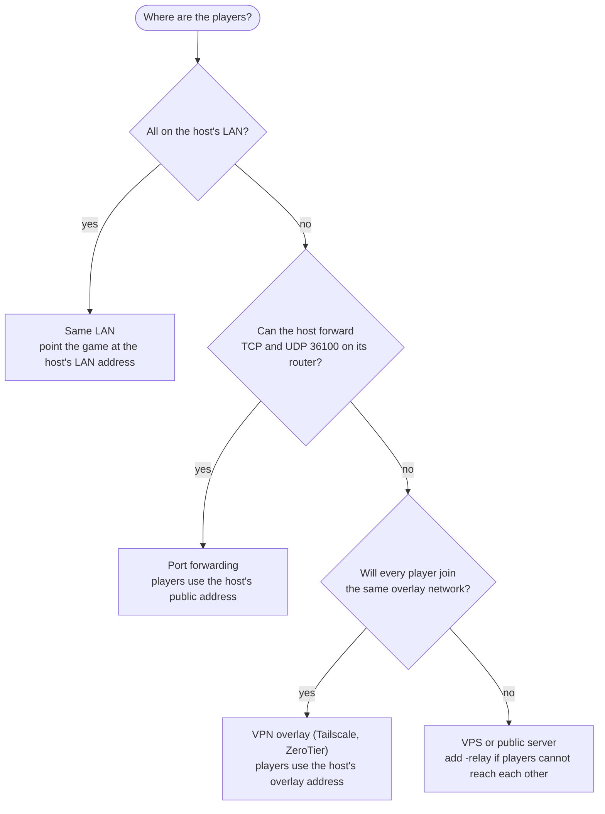
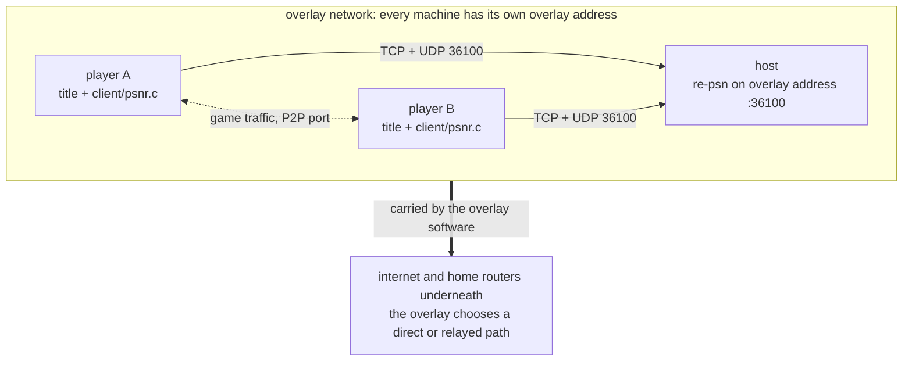
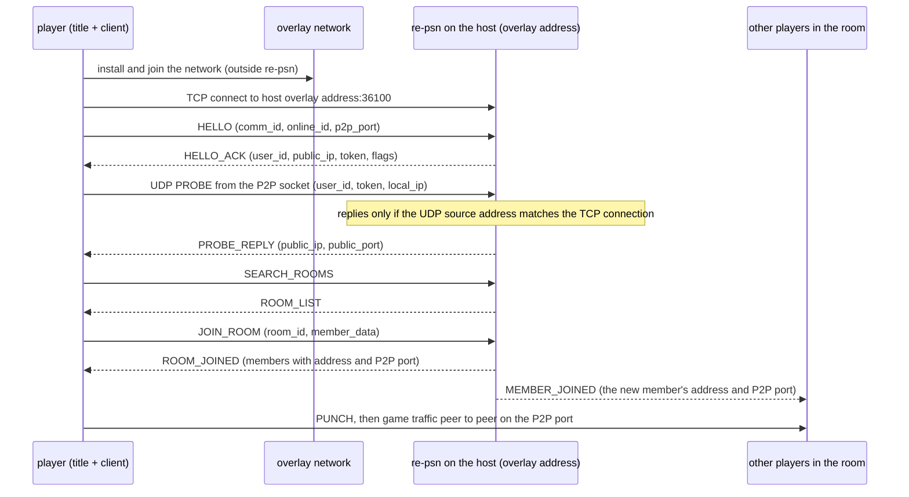

# Connecting players

The ways players can reach a re-psn server: on one LAN, through a port forward on the host's router, through a server with a
public address (with `-relay` when players cannot reach each other), over a VPN overlay network such as Tailscale or ZeroTier,
or behind a reverse proxy. Each comes with what it needs, its limits, and what has and has not been tested. The server's flags
and ports are in [running.md](running.md); the protocol is in [api.md](api.md).

## Contents

- [What the server needs](#what-the-server-needs)
- [Ways to connect](#ways-to-connect)
- [Which one to use](#which-one-to-use)
- [Tailscale](#tailscale)
- [ZeroTier](#zerotier)
- [Other overlay networks](#other-overlay-networks)
- [How a player connects](#how-a-player-connects)
- [What has been tested](#what-has-been-tested)

## What the server needs

Whatever the network, these hold (see [running.md](running.md#ports) and [api.md](api.md#udp)):

| Port | Proto | What uses it |
|---|---|---|
| 36100 | TCP | each player's control connection: HELLO, rooms, leaderboards |
| 36100 | UDP | each player's P2P socket sends PROBEs here, so the server learns the address and port other players should use |
| 36101 | TCP | the status page, only when `-http` is set; keep it on localhost or a LAN, not for players |
| each player's P2P port (3658 unless `PS3_NET_P2P_PORT` says otherwise) | UDP and TCP | game traffic between players, peer to peer |

- **The UDP source address check.** A PROBE (and a datagram sent through `-relay`) is answered only when it comes from the same
  IP address as the player's TCP connection ([running.md](running.md#udp-source-address)). So TCP and UDP 36100 must reach the
  server along the same kind of path, with the player's own source address. `-udp-any-source` turns the check off for networks
  where that is not possible.
- **The address handed to other players** is the one the server sees: the probe's source address and port from another
  network, the player's own `local_ip` from the same one, and the TCP address without a probe. The `local_ip` is kept only if it
  is private (10/8, 172.16/12, 192.168/16), carrier-grade NAT (100.64/10), link-local (169.254/16), or the probe's own source
  address.
- **The server carries no game traffic** unless it runs with `-relay`.

> [!WARNING]
> Every player, including one playing on the host's own machine, should point the game at the address the other players use.
> A player who connects to `127.0.0.1` is handed to the others as `127.0.0.1`, which they cannot reach. This was seen in the local
> simulation under [What has been tested](#what-has-been-tested). By the same reasoning, mixing a player who connects by a LAN
> address with players elsewhere gives those players an address they cannot reach (not tested here).

## Ways to connect

| Way | When to use it | What it needs | Known limits |
|---|---|---|---|
| **Same LAN** | everyone is on the host's home or office network | the host's LAN address; firewall rules for TCP and UDP 36100 on the host and the P2P port on each player ([running.md](running.md#firewall)) | none beyond the firewall. Players on one network are given each other's LAN addresses. |
| **Port forwarding** | players are elsewhere and the host controls its router | TCP and UDP 36100 forwarded to the host, with the source address left unchanged; each player's P2P port reachable, or hole punching | UDP must reach the server unchanged: a forwarder that rewrites the source makes every probe fail the check. A player behind a router that picks a new port per destination (symmetric NAT) cannot be reached by hole punching; the server needs `-relay` for them. |
| **VPS or public server** | nobody can forward a port, or the host wants the server always on | a machine with a public address, TCP and UDP 36100 open on it; `-relay` when players cannot reach each other directly | with `-relay`, relayed game traffic uses the server's bandwidth. Without it, symmetric NAT players need a port forward or an overlay. See [a relayed connection](architecture.md#a-relayed-connection). |
| **VPN overlay** (Tailscale, ZeroTier) | friends who can all install the same overlay software | every player and the host on one overlay network; the host's overlay address; the overlay's access rules allowing TCP and UDP 36100 and the P2P port | not tested here with a real overlay. Everyone, including the host's own game, must use overlay addresses. See [Tailscale](#tailscale) and [ZeroTier](#zerotier). |
| **Behind a reverse proxy** | the host already runs Traefik, nginx or HAProxy in front of its services | PROXY protocol on the game TCP port, `-trusted-proxies` and `-proxy-protocol` ([running.md](running.md#behind-a-reverse-proxy), [deploy/](../deploy/README.md)) | TCP only: UDP 36100 is published straight to the server, never through the proxy. Only the Traefik example has been run. |

**A LAN server with some players outside.** By default a player who connected over the LAN is given to players elsewhere as an address they cannot reach. Start the server with `-lan-public-addr IP` (`RE_PSN_LAN_PUBLIC_ADDR`, IPv4, off by default), where IP is the address players outside reach the host at. Those players are then given IP and the LAN player's P2P port. The host's router must forward each such player's P2P port to that player; several LAN players behind one forward need distinct P2P ports. Players on private addresses keep getting LAN addresses. If the direct connection still fails, `-relay` covers it.

## Which one to use

The decision flow below picks a way to connect from where the players are.

A reverse proxy is not a separate branch: it sits in front of a server reached by port forwarding or on a VPS.

On an overlay, each machine has its own overlay address, and re-psn sees only those; how the packets cross the internet
underneath is the overlay's job.

What follows from the code for an overlay (reasoning, not a run over a real overlay):

- TCP and UDP from a player both leave from that player's overlay address, so the UDP source address check holds.
- The client takes `local_ip` from its own end of the TCP connection, which is its overlay address, the same as the probe's
  source, so the server keeps it whatever range the overlay uses.
- There is no NAT inside the overlay, so the probed address equals the player's own address, and the server does not mark the
  player as needing the relay for streams. `-relay` is not needed on an overlay.
- The protocol carries IPv4 addresses only and the C client resolves names to IPv4 only, so use the overlay's IPv4 address.

## Tailscale

Tailscale builds a private network, a tailnet, out of the devices signed in to it, with traffic between them encrypted by WireGuard.
Each device gets an IPv4 address from 100.64.0.0/10.

**Host and players, in outline:**

1. Install Tailscale on every machine and sign in to the same tailnet (`tailscale up`).
2. On the host, start re-psn as usual. The default `-addr :36100` listens on every address, the tailnet one included.
3. Find the host's IPv4 tailnet address with `tailscale ip -4` on the host.
4. Point each game at it: `PSNR_SERVER=100.x.y.z:36100`. The host's own game uses the same address, not `127.0.0.1`.

**What to check:**

- **Access rules.** A new tailnet allows all traffic between its devices. If the tailnet has its own policy (ACLs or grants),
  it must let players reach the host on TCP and UDP 36100, and each other on the P2P port.
- **Names or addresses.** With MagicDNS a machine name can stand in for the address (`PSNR_SERVER=hostname:36100`). The C
  client looks the name up as IPv4. The address itself avoids any doubt.
- **Direct or relayed.** `tailscale status` and `tailscale ping` show whether a peer is reached directly or through a relay.
  Either way the packets should arrive with the sender's tailnet address, so re-psn should behave the same with more
  latency (reasoning, not tested here).
- **Firewalls.** Tailscale's own traffic usually needs no open ports. The host's firewall may still need to allow 36100 on the
  Tailscale interface; [running.md](running.md#firewall) has the commands.

**Official documentation** (each link returned HTTP 200 on 2026-11-05):

| Topic | Link |
|---|---|
| Documentation index | <https://tailscale.com/docs> |
| Quickstart | <https://tailscale.com/docs/how-to/quickstart> |
| Tailscale IP addresses | <https://tailscale.com/docs/concepts/tailscale-ip-addresses> |
| CLI (`tailscale up`, `tailscale ip`, `tailscale status`) | <https://tailscale.com/docs/reference/tailscale-cli> |
| ACLs | <https://tailscale.com/docs/features/access-control/acls> |
| Grants | <https://tailscale.com/docs/features/access-control/grants> |
| MagicDNS | <https://tailscale.com/docs/features/magicdns> |
| Connection types | <https://tailscale.com/docs/reference/connection-types> |
| DERP relay servers | <https://tailscale.com/docs/reference/derp-servers> |
| Subnet routers | <https://tailscale.com/docs/features/subnet-routers> |
| Firewall ports | <https://tailscale.com/docs/reference/faq/firewall-ports> |

> [!NOTE]
> A subnet router puts a whole LAN behind one tailnet device. Players reached that way may arrive with an address that is not
> their own, which the UDP source address check can refuse. Install Tailscale on each player's machine instead. This is
> reasoning from the code, not tested here.

## ZeroTier

ZeroTier joins devices into a virtual network identified by a 16-character network ID, managed from ZeroTier Central. A device that joins must be authorized on the network before it can talk to the others, and gets the
address the network's settings assign.

**Host and players, in outline:**

1. The host creates a network in ZeroTier Central and shares its network ID with the players.
2. Everyone installs ZeroTier and joins the network (`zerotier-cli join <network ID>`, or the desktop app).
3. The host authorizes each new member in Central.
4. Find the host's ZeroTier address in Central's member list, or with `zerotier-cli listnetworks` on the host.
5. Start re-psn on the host and point each game at that address: `PSNR_SERVER=<address>:36100`. The host's own game uses
   it too.

**What to check:**

- **Authorization.** A member that is not authorized gets no traffic through.
- **Flow rules.** In ZeroTier Central, flow rules start off, with all traffic allowed. If the network has rules, they must accept TCP and UDP
  36100 to the host and the P2P port between players.
- **Names or addresses.** Use the address; this page does not cover DNS for ZeroTier networks.
- **Direct or relayed.** ZeroTier tries a direct path between devices and relays when it cannot make one. `zerotier-cli peers`
  lists the path to each peer. Relayed or not, packets should arrive with the sender's ZeroTier address (reasoning, not
  tested here).
- **Managed routes.** A route that sends a whole LAN through one member brings the same caution as a Tailscale subnet router:
  players behind it may not arrive with their own address (reasoning, not tested here).

**Official documentation** (each link returned HTTP 200 on 2026-11-05):

| Topic | Link |
|---|---|
| Documentation index | <https://docs.zerotier.com/> |
| Getting started | <https://docs.zerotier.com/start/> |
| CLI (`join`, `listnetworks`, `peers`) | <https://docs.zerotier.com/cli/> |
| ZeroTier Central | <https://docs.zerotier.com/central/> |
| Flow rules | <https://docs.zerotier.com/rules/> |
| Routing between a ZeroTier network and a LAN (managed routes) | <https://docs.zerotier.com/route-between-phys-and-virt/> |
| Protocol: direct paths and relaying | <https://docs.zerotier.com/protocol/> |
| TCP relay | <https://docs.zerotier.com/relay/> |
| Firewalls | <https://docs.zerotier.com/corporate-firewalls/> |
| Troubleshooting | <https://docs.zerotier.com/troubleshooting/> |

## Other overlay networks

Other overlays should work the same way as long as every player has their own address on the overlay and TCP and UDP both
travel over it. None of these has been tested with re-psn:

| Overlay | Official documentation |
|---|---|
| NetBird | <https://docs.netbird.io/> |
| Headscale (a self-hosted Tailscale control server) | <https://headscale.net/stable/> |
| WireGuard, configured by hand | <https://www.wireguard.com/quickstart/> |

## How a player connects

The sequence below follows [api.md](api.md) for a player on an overlay; on a LAN or over the internet only the first step
changes.

A room created with an invite code is joined with JOIN_BY_CODE instead of SEARCH_ROOMS and JOIN_ROOM.

## What has been tested

| Claim | How it is known |
|---|---|
| A `local_ip` in 100.64/10, private or link-local ranges is kept; a public one that is not the source is dropped | `TestUsableLocalIP` and `TestProbeDropsPublicLocalIP` in `server/udp_test.go` |
| A probe from another address than the TCP connection gets no reply | `TestProbeFromOtherAddressRefused` |
| Players behind NATing routers, with and without `-relay` | the [NAT lab](../lab/README.md) scenarios |
| Two players with 100.64.0.x addresses reach each other directly, with and without `-relay` | a local simulation: Linux network namespaces with 100.64.0.1 (server), 100.64.0.2 and 100.64.0.3 (players), routed with no NAT, running the server and two `lab/natcheck` players. Both pinged and streamed directly. This imitates an overlay's addressing only; no VPN software was involved. |
| A player connected by `127.0.0.1` is handed to others as `127.0.0.1` | the same simulation, with one player connecting by loopback: the other player was given `127.0.0.1:3658` and its ping failed |
| The port of J-STARS Victory VS+ (US build) creates and joins a room on re-psn v0.3.0: two copies on one Linux PC over loopback, both reached the same Friendly Match and its fight, and the title's NP signaling connected both ways | the title's own test run, with the re-psn log: one room created by the first player, joined by the second, closed at the end, no warnings or refusals. Not run: Rank Match (no leaderboard calls were made), a Windows build, two separate PCs, the EU build |
| re-psn over a real Tailscale tailnet or ZeroTier network | **not tested here** |
| re-psn over NetBird, Headscale or plain WireGuard | **not tested here** |
| A Tailscale subnet router or ZeroTier managed route in front of players | **not tested here**; the caution above is reasoning from the code |

The upstream architecture notes say a shared VPN such as Tailscale works for players behind routers that cannot be reached
directly ([architecture.md](architecture.md#why-the-server-doesnt-carry-game-traffic)); no run of it is recorded in this
repository.
