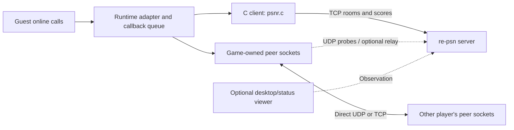

# Integrating re-psn into a recompiled game

Start with the runtime your port already uses. re-psn supplies matchmaking rooms, room data/messages, leaderboards,
peer endpoints and optional relay transport. The runtime adapter translates the game's online calls and delivers
callbacks; the game/runtime still implements its gameplay protocol. A successful room join does not establish that
the game's peer traffic, synchronization or proprietary backend works.

## Choose an integration path

| Your project | Start here |
|---|---|
| A ps3recomp port using its NP modules | Keep its existing `np_psnr` bridge and vendored C client; configure and test that path. Do not link a second client copy. |
| Another recomp runtime or a custom online adapter | Vendor the C client, map your runtime's asynchronous operations and implement peer transport around it. |
| A title that has its own game server | Use re-psn as a side service for rooms and leaderboards only: [Running re-psn beside a title's own server](side-service.md). |
| A tool inspecting a running server | Use the optional [HTTP status API](api.md#http); it is separate from the game protocol. |

This guide was checked against re-psn main `15bb542fd5a27d539781691d5bc9dca16244314b` and ps3recomp
[`de4f090328ea08bef6b2f15caec0b85e343a7ece`](https://github.com/sp00nznet/ps3recomp/tree/de4f090328ea08bef6b2f15caec0b85e343a7ece)
on 2026-11-07. The C example is compiled and run by this repository's required native-client check. Runtime observations
below are source inspection at that pin, not an executed game-compatibility claim. Record your exact server, client,
runtime and title-build revisions when testing; later versions can differ.

The pin is older than `main`. Later changes (player-reported latency, the lobby view, `-relay-force` and server-side peer keys) are not
covered by this guide's source inspection and are in v0.5.0, not v0.4.0; see the [CHANGELOG](../CHANGELOG.md).



The desktop app is not currently a game-control proxy or automatic launcher. Games connect to the server directly.
The app's `re-psn.ini` is not automatically loaded by the C client or the inspected runtime. Discovery, game-launch
profiles, provider verification and Anonymous/Verified/Both relay admission remain separate planned work.

## First: test the server and C client without a game

From the repository root, use Go and a C compiler. The server module's minimum Go version is in [go.mod](../go.mod);
the combined app checks require the newer version in [app/go.mod](../app/go.mod). On Linux, `nix develop` supplies
the pinned development tools.

Terminal 1, loopback only, HTTP off and memory storage:

```sh
go run ./server -addr 127.0.0.1:36100 -http "" -db off
```

Terminal 2, build and run the [minimal C example](../client/examples/minimal.c):

```sh
cc -std=gnu11 -Wall -Wextra -Iclient client/psnr.c client/examples/minimal.c -o /tmp/re-psn-minimal
/tmp/re-psn-minimal 127.0.0.1 36100 demo_one
```

Success prints `HELLO user=...` and `ROOM_LIST total=... count=...`, then closes the connection. The example uses the
synthetic communication ID `RE-PSN-DEMO`, advertises peer port zero and has no peer socket. An empty list is expected
on a fresh server. It demonstrates blocking setup and reply ownership, not an engine frame loop or multiplayer gameplay.
It reads no game data and connects only to the HOST you give it.

For an automated check that builds its own temporary loopback server and fails if native execution skips:

```sh
python3 tools/check_conformance.py --require github.com/sp00nznet/psnr/server:TestCClient -- go test -count=1 -json ./server -run '^TestCClient$'
```

The test runs the existing multi-client conformance client and this example, including invalid arguments and empty/
populated room lists. For the C client plus the three Go app-client scenarios, use `python3 tools/loopback.py --race`;
see [testing.md](testing.md) for prerequisites, deadlines and coverage limits. Neither check runs a game or proves NAT
reachability. These commands were exercised on Linux; use the PR's hosted results for platform-specific evidence.

## Existing ps3recomp ports

### Build and initialize the existing bridge

At the inspected pin, the runtime CMake source collection already includes the NP bridge and vendored client. A port
using the standard runtime target should retain its normal HLE initialization, system-module registration and NID
setup. There is no separate re-psn CMake switch to turn on. Avoid duplicate `psnr.c` objects or a second client manager.
Check your port's modified build and launch code rather than assuming every project follows the template.
[Runtime CMake](https://github.com/sp00nznet/ps3recomp/blob/de4f090328ea08bef6b2f15caec0b85e343a7ece/CMakeLists.txt#L29-L45),
[project template](https://github.com/sp00nznet/ps3recomp/blob/de4f090328ea08bef6b2f15caec0b85e343a7ece/templates/project/CMakeLists.txt#L69-L99).

### Configure before process startup

For a portable baseline, set the environment before starting the executable. Keep the normal executable arguments
required by your own port. Run two instances in separate terminals with different names and peer ports:

```sh
# Terminal A: replace ./your-recompiled-game with your own port's executable and usual arguments.
PS3_NET_ONLINE=1 PSNR_SERVER=127.0.0.1:36100 PS3_NP_ONLINE_ID=DevOne PS3_NET_P2P_PORT=3658 ./your-recompiled-game

# Terminal B
PS3_NET_ONLINE=1 PSNR_SERVER=127.0.0.1:36100 PS3_NP_ONLINE_ID=DevTwo PS3_NET_P2P_PORT=3659 ./your-recompiled-game
```

PowerShell equivalent for the first instance; use another window with `DevTwo` and port `3659` for the second:

```powershell
$env:PS3_NET_ONLINE = '1'
$env:PSNR_SERVER = '127.0.0.1:36100'
$env:PS3_NP_ONLINE_ID = 'DevOne'
$env:PS3_NET_P2P_PORT = '3658'
& .\your-recompiled-game.exe
```

The inspected bridge checks whether variables are present: `PS3_NET_ONLINE=0` still enables its online path when
`PSNR_SERVER` is set. Remove the online variables for an offline run, and restart the process after changing cached
configuration. Use a valid online name starting with a letter, 3–16 letters/digits/`-`/`_`, and peer port 1–65535.
That name rule is the desktop app's and this guide's advice. The server itself only needs a non-empty communication ID (12 bytes
at most) and takes a name of up to 16 bytes as sent, empty included. It compares names without regard to case, and the C client
truncates longer values. The port parser does not validate that range for you. `PSNR_SERVER` is a host or IPv4 address with an optional port
(default 36100), not an HTTP URL. The C transport uses IPv4; use a name resolving to IPv4 or an IPv4 literal.
[Setup and enable checks](https://github.com/sp00nznet/ps3recomp/blob/de4f090328ea08bef6b2f15caec0b85e343a7ece/libs/network/np_psnr.c#L60-L100).

The boot test runner implements `--psnr` and `--username`; the standard project launcher at this pin does not. Add
those flags only if your launcher parses them and calls `np_psnr_setup` before the first environment lookup. Explicit
setup can override inherited endpoint/name settings; do not advertise universal flag precedence without checking your
launcher. Leave tracing unset unless needed: `PS3_NET_TRACE=0` still enables presence-based tracing.
[Boot runner](https://github.com/sp00nznet/ps3recomp/blob/de4f090328ea08bef6b2f15caec0b85e343a7ece/runtime/ppu/tests/boot_main.cpp#L1093-L1112),
[template launcher](https://github.com/sp00nznet/ps3recomp/blob/de4f090328ea08bef6b2f15caec0b85e343a7ece/templates/project/main.cpp#L405-L450).

### Preserve callback and connection ownership

Matching2 context start or Score title-context creation initiates the shared connection. It uses the title's NP
communication ID, a 12-byte protocol field such as `NPWR00001_00`; a disc/product ID is not a substitute. Keep the same
actual communication ID across participating instances. The inspected bridge owns one process-global client, scoped
by its first connection, rather than one independent connection for each guest context.

`cellSysutilCheckCallback` pumps network completions and then drains guest callbacks. Score polling/waiting can also
pump the bridge. Preserve the runtime's synchronization and guest completion queues; do not call guest callbacks
directly from an arbitrary host network thread or assume the entire bridge has one exclusive caller.
[Connection lifecycle](https://github.com/sp00nznet/ps3recomp/blob/de4f090328ea08bef6b2f15caec0b85e343a7ece/libs/network/np_psnr.c#L120-L173),
[sysutil pump](https://github.com/sp00nznet/ps3recomp/blob/de4f090328ea08bef6b2f15caec0b85e343a7ece/libs/system/cellSysutil.c#L216-L229),
[Score pump](https://github.com/sp00nznet/ps3recomp/blob/de4f090328ea08bef6b2f15caec0b85e343a7ece/libs/network/sceNpScore.c#L139-L160).

At this pin the bridge attempts connection once per process and provides no general reconnect/shutdown API. Start the
server first; restart the game after an initial connection failure or disconnect. NP manager ONLINE reflects startup
configuration, not a completed handshake or authenticated identity. Check the actual server HELLO and title callbacks.
Public-room formats align by source comparison; current server invite-code operations do not have a Matching2 bridge
API here. NP room flags/passwords do not automatically become re-psn invite codes.
[Manager status](https://github.com/sp00nznet/ps3recomp/blob/de4f090328ea08bef6b2f15caec0b85e343a7ece/libs/network/sceNp.c#L246-L274),
[room translation](https://github.com/sp00nznet/ps3recomp/blob/de4f090328ea08bef6b2f15caec0b85e343a7ece/libs/network/sceNpMatching2.c#L1124-L1165).

## Direct C/C++ integration

Vendor [psnr.c](../client/psnr.c) and [psnr.h](../client/psnr.h) from the **same reviewed commit**, preserving the
[licence](../LICENSE) and [credits](../NOTICE.md). Compile the `.c` file as C and include the header from C++ through
its existing `extern "C"` guards. Windows links Winsock (`ws2_32`); a MinGW-w64 build uses the same compile inputs
with `-lws2_32` and an `.exe` output. Do not infer MSVC/MinGW runtime validation from a Linux test result.

For a CMake target, adapt the paths and existing executable target:

```cmake
add_library(re_psn_client STATIC vendor/re-psn/psnr.c)
target_include_directories(re_psn_client PUBLIC vendor/re-psn)
target_compile_features(re_psn_client PUBLIC c_std_11)
if(WIN32)
  target_link_libraries(re_psn_client PUBLIC ws2_32)
endif()
target_link_libraries(your_game_target PRIVATE re_psn_client)
```

The public C declarations are the integration surface. The desktop Go client lives under `app/internal/client`;
Go's `internal` boundary makes it unsuitable as an external SDK import. The standalone Go server is not an embeddable
game library. Other languages need an FFI wrapper or a separately tested implementation of [the wire protocol](api.md).

### Own the client and every returned message

| Operation | Adapter responsibility |
|---|---|
| Connect | Call `psnr_connect`, supplying the real communication ID, player name and actual bound peer port; handle NULL. DNS, TCP and HELLO setup can block. |
| Send | Save the nonzero ID returned by `psnr_send` in a pending-request table. It transmits synchronously and may wait for writability. |
| Pump | Call `psnr_poll` regularly; 1 returns a message, 0 means nothing ready, -1 means disconnected after queued messages are drained. Its HEARTBEAT carries the player's round trip, timed from the library's own calls (`psnr_rtt_ms`); it is off until you call `psnr_report_rtt(c, 1)`, which is recommended. |
| Complete | `req == 0` is a push; otherwise correlate by the returned request ID. Validate type and payload length before decoding big-endian fields. |
| Release | Call `psnr_msg_free` for every returned message, including errors, pushes and late replies. Copy any data retained after dispatch. |
| Close | The serialized owner calls `psnr_close`; invalidate pending guest requests and cached room/member IDs. Close application-owned peer/relay sockets separately. |
| Discover (optional) | `psnr_discover(port, timeout_ms, out, max)` broadcasts one UDP request from its own temporary socket and returns the LAN servers that answered; it blocks for up to `timeout_ms`, so run it on the networking owner, not in a frame callback. Discovery is opt-in on the server: only servers started with discovery on answer. It does not cross subnets or client-isolated Wi-Fi, and on Windows it broadcasts to 255.255.255.255 only. Keep a manual `host:port` path. |

Use one serialized owner for each `psnr_client`. For a new adapter, keep transport work on a host networking owner
with queues to/from the guest callback thread, rather than putting potentially blocking work in a timing-sensitive
frame/callback path. The library creates no threads. Polling receive work does not wait for new data, but automatic
heartbeat transmission can wait on socket writability. It is not a hard-real-time API or an independently running
heartbeat timer. Poll regularly enough to send the 20-second idle heartbeat before the server's 90-second idle timeout.

`psnr_call` is convenient for the synthetic example and setup: its reply-wait timeout starts **after** transmission,
does not bound DNS/connect/send, and does not cancel a request. A late reply can still arrive; a timed-out room creation
may already have happened. Do not blindly retry side-effecting operations. `psnr_connect_error` is process-global last
HELLO diagnostic state and can retain a prior error on an earlier-stage failure; it is not a definitive cause for
every NULL return. Serialize connect attempts and reads of this shared diagnostic across clients. Plan and test
cancellation/shutdown behavior rather than assuming a timeout interrupts all I/O.

On Windows, preserve SOCKET width for returned stream handles and close them with `closesocket`. Coordinate Winsock
lifetime with the host runtime: this C-client snapshot calls `WSAStartup` on connect and does not balance it with
`WSACleanup`. These are current API constraints, not automatic cleanup or reconnection guarantees.

### Translate operations deliberately

Use [api.md](api.md) for payloads, reply/push formats and refusal codes. Map room create/search/join/leave, data/message
updates and scores to the game's expected results and asynchronous callbacks. Treat request IDs, room IDs, member IDs
and user IDs as different fields. Metadata blobs are capped at 4096 bytes. SEARCH_ROOMS omits full and invite-only
rooms; a room can disappear or fill between search and join. A successful HELLO grants no external identity proof or
PSN ticket. Capability flags and exact source pins matter: HELLO has no general protocol-version negotiation field.

On disconnect, complete/cancel pending guest work appropriately and rebuild session state after a deliberate reconnect.
The direct C library does not restore membership. Client disconnect removes live membership; server restart loses
in-memory rooms and scores. Do not promise persistence, authenticated accounts, voice audio, rollback/synchronization,
or a publisher's backend merely because rooms work.

## Peer sockets, NAT and relay

The adapter owns the actual game-facing peer sockets. Send `psnr_probe_packet` from the **same UDP socket** that will
carry that player's peer traffic, to the endpoint from `psnr_server_addr`. Probing from an unrelated temporary socket
discovers the wrong mapping. Announce the bound peer port in HELLO, send periodic probes and peer punches as needed,
and consume `psnr_is_control` / `psnr_probe_reply` traffic before delivering gameplay bytes. The helpers format/read
packets; your transport must schedule I/O, track peer routes and distinguish control from game data.

On receive, recognize and validate relay datagrams from the expected server endpoint before applying a generic
control-packet discard. Unwrap their sender/payload, consume probe replies and punch/control traffic, then deliver
only gameplay bytes with the correct peer identity. Blindly discarding every `psnr_is_control` match first would
discard relay datagrams too. Unwrap with `psnr_relay_unwrap_from(c, src_ip, src_port, ...)` and pass the source address
the UDP socket reports for each datagram: it returns 0 unless the datagram came from the server's UDP address
(`psnr_server_addr`). A title must check the source address of every 0x03 datagram. Any room member knows every other
member's endpoint and can send a relay-shaped datagram straight to the title's UDP port with any sender it names.
`psnr_relay_unwrap` does not check the source: prefer `psnr_relay_unwrap_from`.

The current C helpers assume IPv4 and derive the probe target from the connected server endpoint. Keep the server's
game TCP/UDP address and port aligned as seen by the client for that path. A separate UDP endpoint needs explicit
adapter support. Each local instance needs its own name and peer port; duplicate names on one
source address replace the older connection. The server's UDP source check requires the same source IP as TCP unless
the operator explicitly enables its exception. See [connecting.md](connecting.md) and [running.md](running.md).

Server-bound probes and relay datagrams share the host's per-source-IP UDP allowance: by default 1000 packets/second
with the same-size burst. Players behind one NAT share that allowance across source ports; direct peer-to-peer packets
do not traverse this server limiter. Avoid busy probe loops and test the configured budget with your actual relay
traffic. A zero setting disables the limiter; this is not source authentication or a byte budget. See
[UDP guardrails](udp-guardrails.md) for configuration, drop counters and capacity limits.

With server `-relay`, handle relay capability, ROUTE/STREAM_OFFER pushes and datagram wrapping/unwrapping or separate
stream sockets. Fallback is transport policy, not an automatic property of calling `psnr_connect`. The inspected
ps3recomp runtime already contains optional relay hooks, even though some upstream prose says game traffic is never
relayed. Test the path your own build actually uses. Its helper timeout parameters are not end-to-end deadlines for
all connect/write/body-read operations.
[Runtime socket hooks](https://github.com/sp00nznet/ps3recomp/blob/de4f090328ea08bef6b2f15caec0b85e343a7ece/libs/network/np_psnr.h#L68-L104),
[relay policy](https://github.com/sp00nznet/ps3recomp/blob/de4f090328ea08bef6b2f15caec0b85e343a7ece/libs/network/np_psnr.c#L390-L420).

Do not implement gameplay over the optional HTTP status port. It is observability, and `/healthz` only checks local
serving readiness. Neither establishes peer reachability or title compatibility. A TCP reverse proxy does not forward
the game's UDP automatically; preserve the player's real source address and follow the operator's proxy instructions.

## Acceptance checks before claiming a title works

1. Native example/conformance: exact pinned client compiles, HELLO and room requests succeed on loopback.
2. Two title instances: distinct names/peer ports, correct communication ID, expected room create/search/join/leave,
   data/messages and Score callbacks on the appropriate guest thread. Record actual outcomes, not just NP ONLINE.
3. Peer transport: exchange the game's real payloads, handle host/member departure and reconnect behavior. A room-only
   test does not cover this step.
4. Two machines and network cases: LAN, then an authorized real-router direct/punched path and relay path, including
   relay-off failure. The [Docker NAT lab](../lab/README.md) is synthetic transport evidence, not a game test.
5. Failure handling: server unavailable at startup, refused HELLO, stalled I/O, truncated/unexpected frames, full/missing
   rooms, disconnect, server restart and shutdown. Check frame timing and pending callback cleanup.

For a compatibility report record source/build revisions, OS/compiler, communication ID, tested features, instance/
network topology and exact pass/fail limits. Keep game assets local; publish no keys, saves or private logs. Redact
tokens, addresses and user-specific paths from shared diagnostics. Preserve runtime-specific vendoring adaptations:
at the inspected pin ps3recomp's C client retains host send-flag changes around the otherwise aligned client API.

## Troubleshooting

| Symptom | Check |
|---|---|
| NP says ONLINE but no rooms or server HELLO | ONLINE can mean configuration only; verify bridge linkage/startup, endpoint, context creation and actual handshake. |
| Changing flags/environment has no effect | Confirm the launcher implements those flags; set variables before cached lookup and restart after the bridge's one attempted connection. |
| Starting instance B disconnects A | Use different online names and peer ports; same-address name reuse is reconnect takeover. |
| Search is empty | Check actual NP communication ID, both source pins, full/private-room filtering and that the other instance created a room. |
| Joined room but game stalls | Check guest callback dispatch, actual peer socket mapping, control filtering and gameplay synchronization; test direct and relay transport separately. |
| Idle disconnect or a frame stall | Check serialized pump ownership, heartbeat scheduling and blocking send/call work; reply-wait timeout is not a full-operation deadline. |
| HTTP status fails but the game works | HTTP is a separate opt-in listener/token path; use game-protocol results to assess the control connection. |
