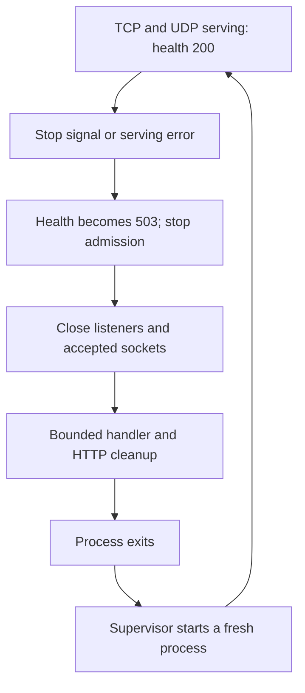

# Health checks and restarts

re-psn runs as one server process. A supervisor can restart it after a failure; a planned restart disconnects players
and starts a fresh server. This page covers the health endpoint and shutdown behavior in v0.4.0 and later; v0.3.0
does not have them. It does not provide standby failover or live room handover.

## Health endpoint

`GET /healthz` is on the existing status listener. Enable that listener with `-http` or `RE_PSN_HTTP`; it stays off
by default and no separate health port is opened. Bind it to loopback for a local supervisor, for example:

```sh
re-psn -http 127.0.0.1:36101
curl --fail http://127.0.0.1:36101/healthz
```

| Result | Meaning |
|---|---|
| `200`, body `ok` | The game TCP and UDP serving loops are active and shutdown has not started. |
| `503`, body `not ready` | Startup is incomplete, either game serving loop has exited, or shutdown has begun. |
| `401` | The existing status-page token is configured and the request did not supply the correct token. |
| Connection refused, EOF or timeout | The status listener is unavailable; treat the probe as failed. |

`HEAD /healthz` returns the same readiness status without a body. Other methods return `405` after authentication.
The response carries no players, addresses, version, scores or settings and tells caches not to store it. It measures
the local game serving loops, not end-to-end reachability, a client's NAT path or the responsiveness of every handler.

The existing `-http-token` / `RE_PSN_HTTP_TOKEN` check also protects `/healthz`. A probe must send the same
`Authorization: Bearer` header used by the status page when that token is configured. The existing query-token form
also works; prefer a header so the token is not part of a probe URL. Never publish a health-probe command containing
your real token.

## What stopping does

SIGINT (Ctrl-C), or SIGTERM on systems that provide it, starts a bounded shutdown. On Windows use Ctrl-C.
Readiness becomes false before the server closes the game listeners and all accepted TCP sockets, including peers
that have not sent HELLO, peers still sending a PROXY header, and pending or paired relay streams. It stops admitting
new clients and lets handlers finish cleanup within a one-second budget. The HTTP server then stops within that same
budget and is closed if necessary. An unexpected serving error follows the same cleanup path and exits nonzero.

Players see their connections close rather than waiting for the normal heartbeat timeout. Their game or client must
reconnect and rebuild any rooms; this does not add automatic reconnection to a client. The server's rooms, names,
relay streams and leaderboard scores are currently in memory, so all are lost on restart. Both `-db off` and
`-db memory` have that limit; a persistent database backend has not been implemented.



## Supervisor settings

The supplied [systemd unit](../deploy/re-psn.service) uses `Restart=on-failure` and `RestartSec=2`. A crash or nonzero
exit requests a restart; a normal stop exits zero. Use `systemctl restart re-psn` for a planned restart. A manual
`systemctl stop re-psn` keeps it stopped. Allow more than the server's one-second shutdown budget before a supervisor
forces termination. No unit installation or system service was changed or run for this feature.

The [Compose example](../docker/docker-compose.yml) uses `restart: unless-stopped`. A restart policy does not itself
poll `/healthz`, and this change adds no Docker healthcheck. A monitor can query the opt-in listener separately. If
you publish it, keep the status-page token and proxy trust configuration appropriate to that listener.

Tests cover loopback readiness, authenticated probes, listener failures, active and incomplete client connections,
relay cleanup, and the existing subprocess stop/replacement scenarios. A real systemd restart, container restart,
remote monitor, Windows console stop and two-host failover have not been exercised for this feature.
